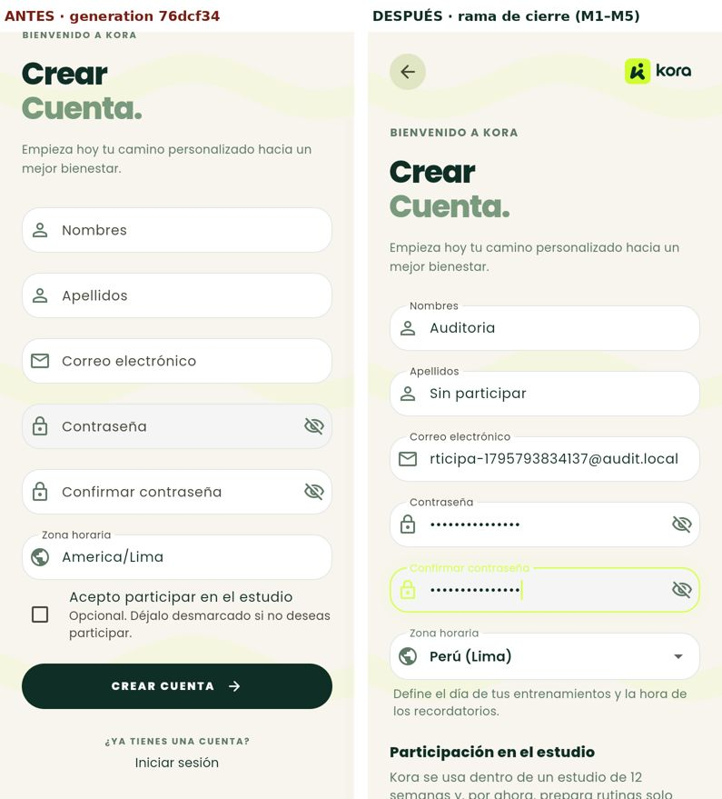
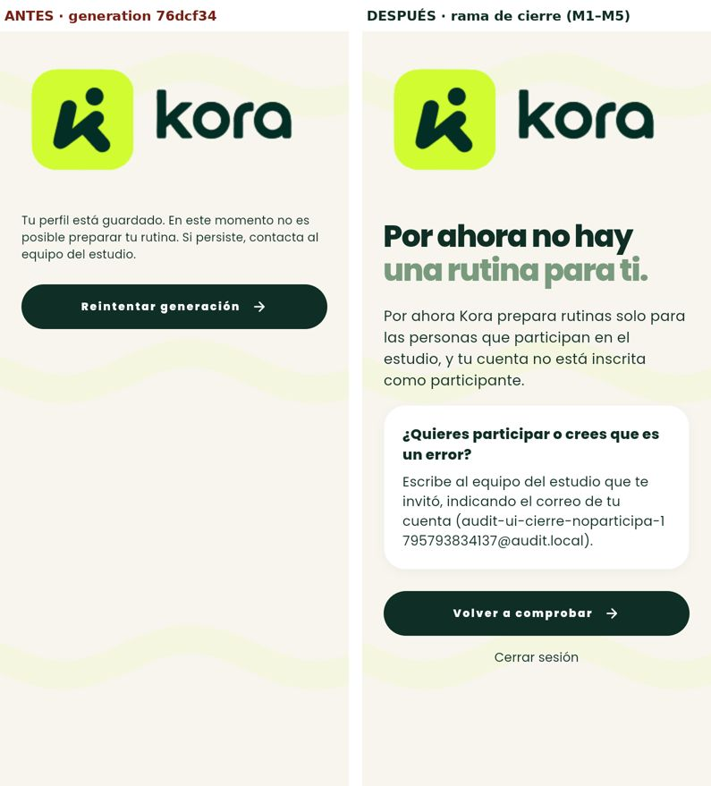

# 02 · Registro, participación y consentimientos (Mobile-M1)

PR Mobile-M1 · rama `claude/mobile-m1-registro-consentimientos` · `947448b` · base `generation` `76dcf34`.
Pendientes: M-01, M-02, M-03, M-27, M-18, M-34.

> **Actualización 28/11/2026 — opción A decidida.** Kora es exclusiva para participantes del estudio; la opción B ya no
> existe en Mobile (`PLANS_FOR_NON_PARTICIPANTS` eliminada en la PR #33). Las versiones de los documentos salen ahora
> de `GET /legal-documents`, no de `--dart-define`. Estado actual: [`docs/integracion_final_estudio/`](../integracion_final_estudio/).
> Lo que sigue se conserva como evidencia histórica.

## 1. Contratos comprobados antes de cambiar nada

| Contrato (Backend `77b9df3`) | Estado |
|---|---|
| `SignUpResource`: `acceptsStudyParticipation`, `acceptedTermsVersion`, `acceptedPrivacyVersion` | Disponible. `acceptedStudyConsentVersion` **no existe**: no se envía |
| `User.isEligibleForPlanGeneration()` = puede iniciar sesión y `isActiveParticipant()` (participante, con consentimiento y sin retirada) | Vigente: el Backend sigue sin generar planes a no participantes |
| `GET /users/me/consents` | Versiones de condiciones y privacidad **nulas**; `enforcedOnSignup=false` |
| Texto o dirección de los documentos | **No lo sirve ningún endpoint** |
| Ramas del Backend con cambios sobre esto | Ninguna nueva desde la auditoría (`git ls-remote` del 27/11/2026) |

## 2. M-01 · Participación: sin callejón sin salida (decisión pendiente)

No se eligió ni la opción A ni la B: eso corresponde al equipo del estudio y al Backend. Lo que se hizo es que **ningún
recorrido termine en un reintento imposible**, de forma coherente con el Backend actual.

| Momento | Antes | Ahora |
|---|---|---|
| Casilla | «Opcional. Déjalo desmarcado si no deseas participar.» | «Kora se usa dentro de un estudio de 12 semanas y, por ahora, prepara rutinas solo para quienes participan» y «Sin participar podrás crear la cuenta, pero no recibirás una rutina.» |
| Crear la cuenta sin marcarla | Se creaba sin aviso | Diálogo «¿Crear la cuenta sin participar?» con «Revisar participación» o «Crear sin participar». Rechazar es posible y sin presión |
| Después de entrar sin ser participante (o tras retirarse, sin plan esta semana) | Perfil de 5 pasos, 30 s de «Generando…» y «Reintentar generación» que siempre fallaba | «Por ahora no hay una rutina para ti»: motivo (no participante / fecha de retirada y datos conservados), contacto del equipo con el correo de la cuenta, «Volver a comprobar» (relee `/users/me` por si el equipo lo inscribe) y «Cerrar sesión». No se llama a la generación |
| Retirado con el plan de esta semana | Entraba | Sigue entrando a ver su plan |

Implementación: `plans/domain/plan_eligibility.dart` (reflejo de `isActiveParticipant`; el Backend sigue siendo la
autoridad), `plans/presentation/no_plan_available_page.dart`, `account_setup_page.dart`.
`--dart-define=PLANS_FOR_NON_PARTICIPANTS=true` prepara la opción B (participación opcional real, sin aviso ni bloqueo)
para cuando el Backend genere planes a no participantes.

**Opción A** (solo participantes) se completa sin código nuevo de bloqueo: con el consentimiento publicado (§3), la
casilla exige leerlo antes, y quien no acepta sabe antes de crear la cuenta que no recibirá rutina. Si el equipo decide
que no debe poder crearse una cuenta sin participar, el cambio es impedir el envío en lugar de preguntar (pequeño).

## 3. M-02, M-03, M-27 · Documentos legibles antes de aceptarlos

**No se inventó ningún texto legal.** Las pantallas funcionan con documentos que aporta la configuración de la
compilación y, mientras no haya documentos aprobados, **no aparece nada y no se envía nada** (estado actual).

| Pieza | Comportamiento |
|---|---|
| `DocumentReaderPage` | Descarga el documento (texto o HTML simple, sin enviar el JWT a esa dirección), lo muestra completo con su versión y solo permite «He leído el documento» al llegar al final. Error con «Reintentar» |
| Registro | Bloque «Documentos» con condiciones y privacidad (solo si hay dirección **y** versión aprobada): cada casilla se habilita al leerlo; ninguna premarcada. El consentimiento del estudio (si `STUDY_CONSENT_URL`) se lee antes de poder marcar la participación |
| Envío | `acceptedTermsVersion` y `acceptedPrivacyVersion` exactamente con la versión mostrada, en el mismo `POST /auth/register` que `acceptsStudyParticipation` (el Backend los guarda en una transacción: no hay cuentas creadas a medias) |
| 422 «no es la vigente» | «Los documentos cambiaron … Tu cuenta no se creó», se reinician las lecturas y hay que leer la versión vigente |
| 422 «no hay una version aprobada» | «Uno de los documentos todavía no está publicado. Tu cuenta no se creó…» |
| Sin conexión | Mensaje de conexión; los campos se conservan; no se navega |
| `ConsentPage` (versión nueva tras iniciar sesión) | Ya no muestra un enlace para copiar: se lee dentro de la app antes de poder aceptarlo. Si la compilación no tiene la dirección, lo dice y no permite aceptar |
| Perfil → Cuenta → Documentos | Participación, condiciones y privacidad con la versión aceptada y «Leer» cuando la compilación tiene ese texto |

Separación respetada: condiciones de uso, política de privacidad y consentimiento de investigación son tres decisiones
y tres casillas distintas.

**Para activarlo** (sin cambiar código): publicar los documentos en una dirección https, configurar en el Backend
`fitsense.consent.terms-version`/`privacy-version` y compilar Mobile con `TERMS_URL`, `TERMS_VERSION`,
`PRIVACY_POLICY_URL`, `PRIVACY_VERSION` y `STUDY_CONSENT_URL`/`STUDY_CONSENT_VERSION` con **los mismos valores**. Solo
entonces encender `enforce-on-signup`.

**Lo que sigue bloqueado:** que el Backend sirva el texto o la dirección por versión (hoy la dirección viaja en la
compilación y debe coincidir a mano) y que la versión del consentimiento del estudio (`MVP-1.0`) corresponda a un
documento aprobado. Mientras tanto **las pantallas no están listas para participantes**: se probaron solo con
documentos sintéticos marcados como tales.

## 4. M-18 · Zona horaria

Lista cerrada de 12 identificadores IANA con nombre en español (Perú por defecto, `DEFAULT_TIMEZONE`). Ya no se puede
escribir «Lima» (que el Backend rechazaba con 400). Se explica que define el día de los entrenamientos y la hora de los
recordatorios.

## 5. M-34 · Entrar tras crear la cuenta

Tras `POST /auth/register` 201 se inicia sesión con las mismas credenciales y se va a la preparación de la cuenta. Si
ese inicio de sesión falla, se vuelve al login con el aviso anterior.

## 6. Pruebas

`test/registration_consents_test.dart` (15) con un Backend simulado que responde como el real
(`test/support/fake_backend.dart`); `test/account_setup_test.dart` (+4); `test/consents_test.dart` (actualizada).

| Caso de la orden | Prueba |
|---|---|
| Registro con documentos vigentes | «each document must be read completely… versions are sent» |
| Registro sin aceptación requerida | «no approved documents: the documents block does not exist» y «ticked: account created…» (sin claves de versión) |
| Documento desactualizado | «outdated version (422)…» |
| Documento no publicado | «document not published (422)…» |
| Usuario que rechaza participar | «unticked: asks before…» y «a person who declines can still create the account knowingly» |
| Usuario que acepta participar | «ticked: account created as participant, then signed in automatically» |
| Registro interrumpido | Leer y salir sin terminar no cuenta como leído; «Revisar participación» no envía nada |
| Error de conexión | «lost connection while creating…» |
| Cuenta no creada parcialmente | 422: no hay navegación y se reinician las lecturas (la transacción es del Backend) |
| Historial coherente con el Backend | `consents_test.dart` (`ConsentStatus` con la respuesta real) y la sección Documentos de Perfil |
| Cuenta no participante / retirada | 4 pruebas nuevas en `account_setup_test.dart` |

Contra el Backend local: registro con y sin participación y rechazo de versiones no publicadas
([`../preproduccion/evidencia/contratos-backend-local.txt`](../preproduccion/evidencia/contratos-backend-local.txt) §1–3);
flujo completo en la app hasta «Por ahora no hay una rutina para ti» (captura `despues/B3-sin-rutina-disponible.jpg`).
