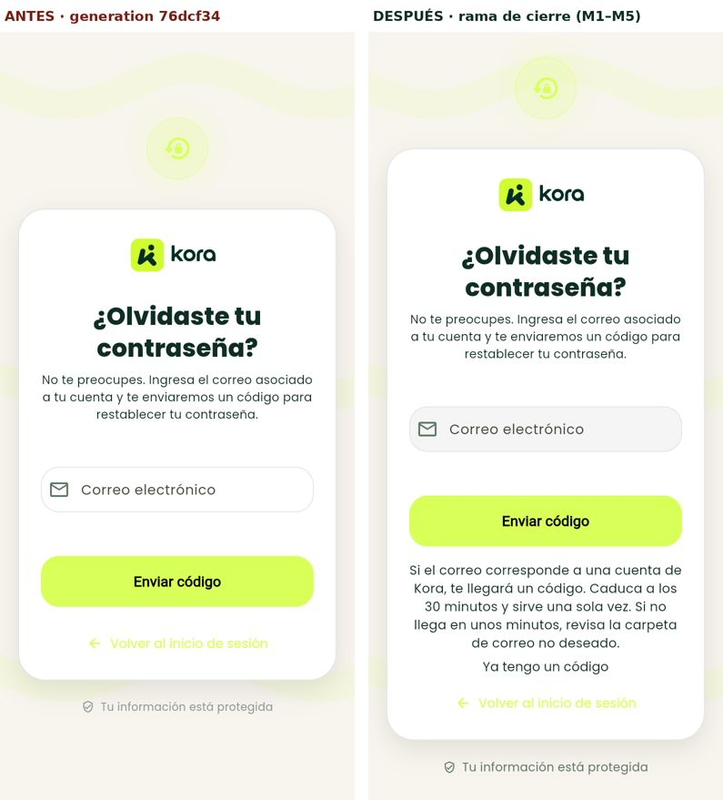

# 03 · Recuperación de contraseña y cuenta (Mobile-M2)

PR Mobile-M2 · rama `claude/mobile-m2-recuperacion-cuenta` · `a3839f9` · base Mobile-M1. Pendientes: M-04, M-26.

## 1. Lo que se reutilizó

Las pantallas `forgot_password_form.dart` y `reset_password_form.dart`, el servicio
(`POST /auth/password-reset/request` y `/confirm`), los mensajes de 400 y 429 y la bandera `PASSWORD_RECOVERY_ENABLED`
**no se reconstruyeron**. El mecanismo de seguridad del Backend (código de 43 caracteres, 30 minutos, un solo uso,
revocación del JWT anterior) no cambia.

## 2. Mejoras

| Paso de la orden | Implementación |
|---|---|
| 1. «¿Olvidaste tu contraseña?» | Igual (detrás de la bandera) |
| 2. Solicitar el correo | Igual; el correo se recuerda en el estado de la recuperación |
| 3. Informar que se enviarán instrucciones si la cuenta corresponde | «Si el correo corresponde a una cuenta de Kora, te llegará un código. Caduca a los 30 minutos y sirve una sola vez. Si no llega en unos minutos, revisa la carpeta de correo no deseado.» |
| 4. Introducir el código | Igual |
| 5. «Ya tengo un código» | Nuevo, en la pantalla del correo: abre la del código sin pedir otro. Cubre el caso de que Android cierre Kora mientras se mira el correo |
| 6. «Pegar código» | Nuevo: pega desde el portapapeles quitando espacios y saltos de línea (`normalizeRecoveryCode`); el código se normaliza también al enviarlo |
| 7. Solicitar uno nuevo | «¿No te llegó o caducó? Pide un código nuevo» vuelve a la pantalla del correo con el correo escrito |
| 8. Caducidad | Explicada en ambas pantallas |
| 9. Conexión perdida | Mensaje de conexión; el código y las contraseñas siguen escritos |
| 10. Confirmación | «Contraseña actualizada correctamente.» |
| 11. Volver al inicio de sesión | Con el correo ya escrito (`/login?correo=`) |

Accesibilidad: la línea «Tu información está protegida» desbordaba con texto grande (detectado por las pruebas) y tenía
contraste bajo; ahora se ajusta y usa el color de 4,8:1.

No se implementaron App Links (no hay decisión sobre enlaces de recuperación).

## 3. Configuración

- **Compilación de pruebas:** `--dart-define=PASSWORD_RECOVERY_ENABLED=true` (lo usa la compilación web de esta
  validación).
- **Distribución para participantes:** la bandera queda **apagada** mientras el Backend de producción tenga
  `fitsense.password-reset.delivery=none` y `fitsense.mail.transport=none`. Con la bandera apagada, «¿Olvidaste la
  clave?» dice que la recuperación todavía no está disponible y remite al equipo del estudio.

## 4. Pruebas

`test/password_recovery_flow_test.dart` (12) contra un simulador del contrato real:

| Caso | Resultado |
|---|---|
| Solicitud válida | ✓ cuerpo `{email}`, pantalla del código, «Lo pediste para …» |
| Correo inexistente | ✓ mismo comportamiento (202 en ambos) |
| Código correcto | ✓ cuerpo `{token, newPassword}` exacto, vuelta al login con el correo |
| Código incorrecto, caducado, ya utilizado (400) | ✓ un mensaje claro, campos conservados, «Pide un código nuevo» con el correo |
| Solicitud repetida | ✓ cada una se envía y se contesta igual |
| 429 | ✓ «Espera un rato…» |
| Pérdida de conexión | ✓ mensaje de conexión, código en pantalla |
| Aplicación cerrada durante el proceso | ✓ «Ya tengo un código» abre la pantalla del código sin nueva solicitud |
| Pegar | ✓ quita espacios y saltos |

**Contra el Backend local (perfil `local-dev`, entrega `dev-log`):**

- Contrato: código de 43 caracteres, caduca a los 30 min, un solo uso, **JWT anterior → 401**, clave anterior 401 y nueva
  200 ([`../preproduccion/evidencia/recuperacion-backend-local.txt`](../preproduccion/evidencia/recuperacion-backend-local.txt)).
- **En la app real** (compilación web con la bandera): solicitud 202 → código leído del log local y escrito en la app →
  confirmación 204 → login con el correo escrito → inicio de sesión 200 con la clave nueva
  ([`evidencia/recuperacion-app-backend-local.txt`](evidencia/recuperacion-app-backend-local.txt); capturas
  `despues/A5`, `A8`, `A9`).

**Obligatoria y pendiente:** la prueba con **correo real** (proveedor configurado, remitente, plantilla), sin la cual el
flujo no puede declararse listo. Tampoco se probó en un teléfono.

## 5. M-26 · Eliminación de cuenta

Revisada sin cambios: pantalla, confirmación, borrado de los datos locales de esa cuenta y bandera
`ACCOUNT_DELETION_ENABLED` (apagada por defecto). La vía web pública depende del correo del Backend y de una página que
aún no existe (`ACCOUNT_DELETION_WEB_URL` vacía). No se modificó la política de conservación de datos.
