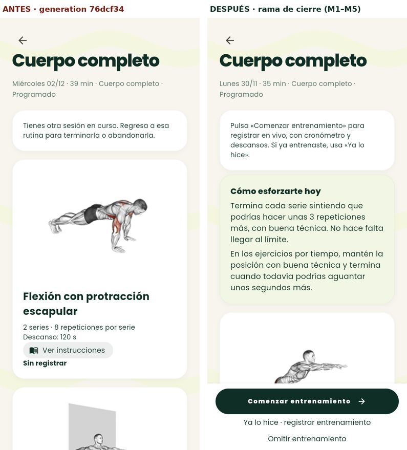
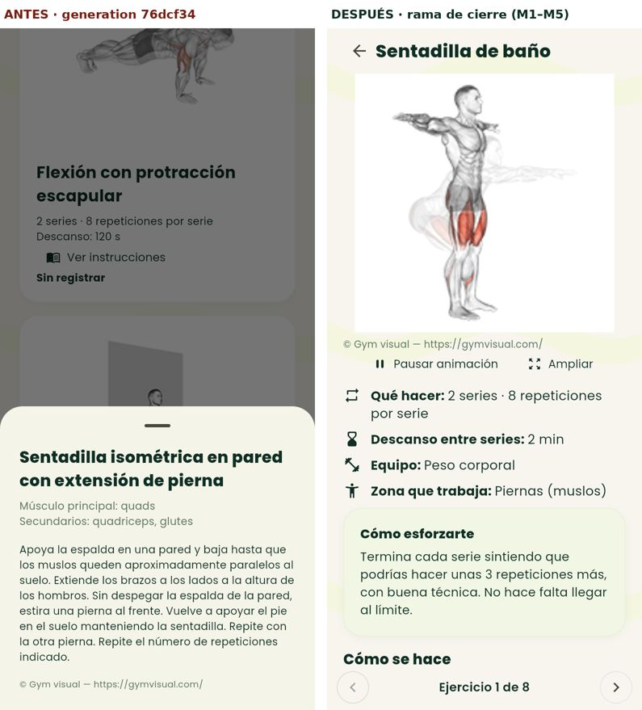
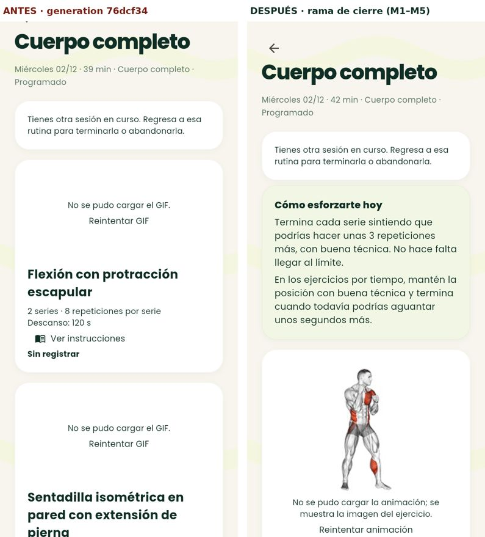

# 04 · Visualización de ejercicios (Mobile-M3)

PR Mobile-M3 · rama `claude/mobile-m3-ejercicios` · `1ce8779` · base Mobile-M2. Pendientes: M-06, M-07, M-08, M-09.

Objetivo: entender cómo hacer cada ejercicio sin perder el contexto del entrenamiento. Se reutilizaron los GIF, las
instrucciones del catálogo, las series, repeticiones y descansos existentes; **no se redactó ninguna explicación
técnica de ejercicios** ni se reemplazó ninguna animación.

## 1. M-07 · Guía de esfuerzo

El plan trae `effortGuidance` (comprobado contra el Backend local: `repsInReserve`, `setsRepsText`, `durationText`,
`loadText`). Mobile no lo mostraba.

| Dónde | Qué se muestra |
|---|---|
| Arriba de la rutina, «Cómo esforzarte hoy» | Los textos que aplican a esa rutina, una vez cada uno: series y repeticiones si hay ejercicios por repeticiones, tiempo si hay ejercicios por tiempo, carga si hay carga sugerida o equipo externo |
| Ficha de cada ejercicio, «Cómo esforzarte» | El texto de su tipo de prescripción y, con equipo externo, el de la carga |

Los textos son **idénticos** a los del Backend (prueba). Si el plan no trae guía no se muestra nada. La guía se lee del
plan que abre la rutina y se refresca cada vez que la rutina se confirma con el Backend.

## 2. M-09 · Ficha del ejercicio

La hoja inferior que tapaba la animación se sustituyó por una **pantalla completa** que se abre con «Ver instrucciones»
o tocando la animación de la tarjeta:

- Animación grande (hasta el 38 % del alto, entre 180 y 360 px) con **«Pausar / Reanudar animación»** (`TickerMode`) y
  **«Ampliar»** (pantalla completa con zoom).
- «Qué hacer» (series × repeticiones o segundos), «Descanso entre series» en minutos («1 min 30 s»), «Equipo»
  (nombre del catálogo), «Zona que trabaja», «Indicación del plan» (`notes`).
- «Cómo esforzarte» (M-07) y «Cómo se hace» (instrucciones del catálogo) con músculo principal y secundarios.
- Bloqueo O20 con su explicación, igual que en la rutina.
- Atribución «© Gym visual» bajo la animación.
- «Ejercicio anterior / siguiente» y «Ejercicio N de M» en la barra inferior; «Volver a la rutina» deja la rutina como
  estaba (resultados, pendientes P1 y cronómetro intactos).
- «Tengo dolor o molestias» (desde M4) devuelve a la rutina con el diálogo abierto.

En la tarjeta de la rutina: «Descanso entre series: 1 min 30 s» y «Equipo: …» en español.

**Corrección de la auditoría:** la auditoría afirmó que los GIF no respetaban «reducir movimiento». Es incorrecto:
Flutter 3.50 pausa las imágenes animadas cuando el sistema lo pide (`image.dart:1189`,
`MediaQuery.disableAnimations`). Se mantiene y se añade la pausa manual.

**Rendimiento:** la lista de la rutina solo construye las tarjetas visibles y las próximas; las que salen se
descartan. No se añadió caché en disco: depende de que el uso de los medios esté autorizado (M-06).

## 3. M-06 · Medios (preparado, no resuelto)

| Situación | Comportamiento |
|---|---|
| El Backend envía `gifUrl`/`imageUrl` https (propuesta de su matriz, aún no implementada) | Se usan esas direcciones; Mobile no construye ninguna |
| No las envía (hoy) | Se mantiene la construcción actual desde `gifPath`/`imagePath` (`EXERCISE_MEDIA_LEGACY_SOURCE=true` por defecto) |
| `EXERCISE_MEDIA_LEGACY_SOURCE=false` | Solo direcciones autorizadas; sin ellas, texto «Este ejercicio no tiene animación disponible» |
| Falla la animación | Imagen fija del mismo ejercicio + «Reintentar animación» |
| Fallan ambas o no hay conexión | «No se pudo cargar la imagen del ejercicio. Revisa tu conexión.» + «Reintentar»; el resto de la tarjeta funciona |
| Atribución | Visible en la ficha |

**No se copió ni redistribuyó ningún archivo.** M-06 sigue **BLOQUEADO POR DECISIÓN** hasta que se documente el
derecho de uso de los medios de Gym visual y se decida el alojamiento.

## 4. M-08 · Información en español

- Músculos y zonas: tablas cerradas de los códigos del catálogo (ExerciseDB) en `workouts/domain/exercise_labels.dart`.
  Un código desconocido **se omite**; nunca se muestra en inglés. El músculo principal no se repite en secundarios.
- Equipo: `nameEs` de `GET /catalog/equipment-types`; si el catálogo no responde, solo se muestra «Peso corporal».
- No se cambian identificadores ni propiedades de los ejercicios. Los nombres técnicos se mantienen: no hay
  descripciones alternativas aprobadas.

## 5. Pruebas

`test/exercise_view_test.dart` (13): guía idéntica al Backend y ausente si no llega; ficha completa con datos en
español; anterior/siguiente y vuelta intacta; pausa (`TickerMode`) y ampliar; abrir desde la animación; tarjeta con
descanso y equipo; **320 × 568 sin desbordamiento** (la prueba encontró y corrigió un desbordamiento real del mensaje
sin imagen); origen de medios autorizado/actual/desactivado; texto y reintento sin medios; etiquetas.
Actualizadas: `exercise_media_semantics_test.dart` (descanso) y `backend_alignment_test.dart` (músculos en español).

Capturas reales (web contra el Backend local): `despues/C4`, `C6`, `C6c`, `D2`, `E1`.
