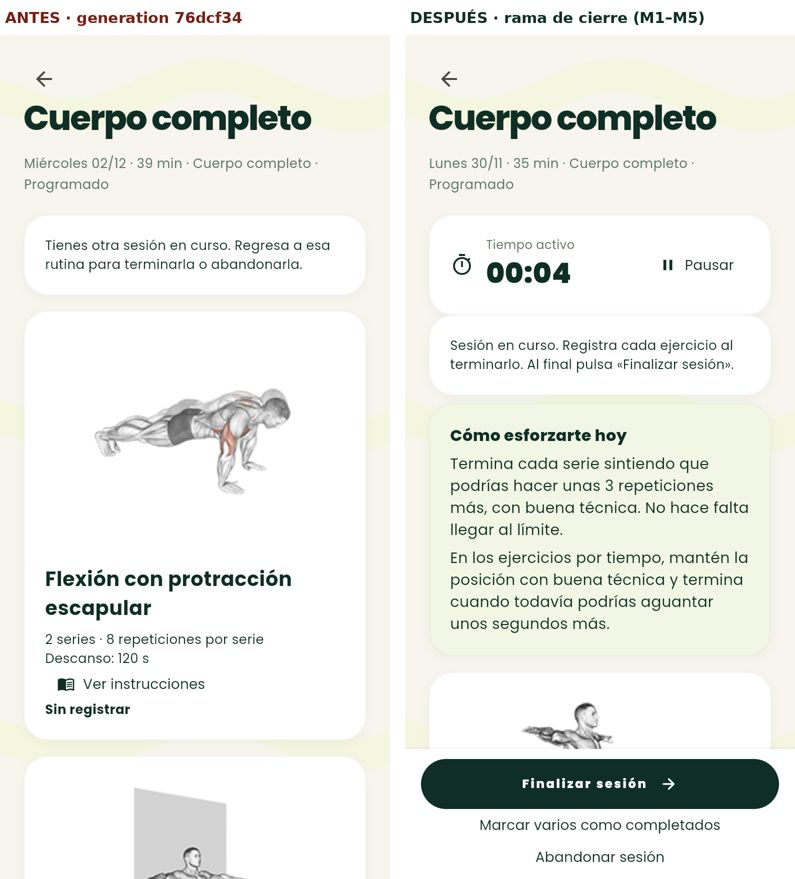
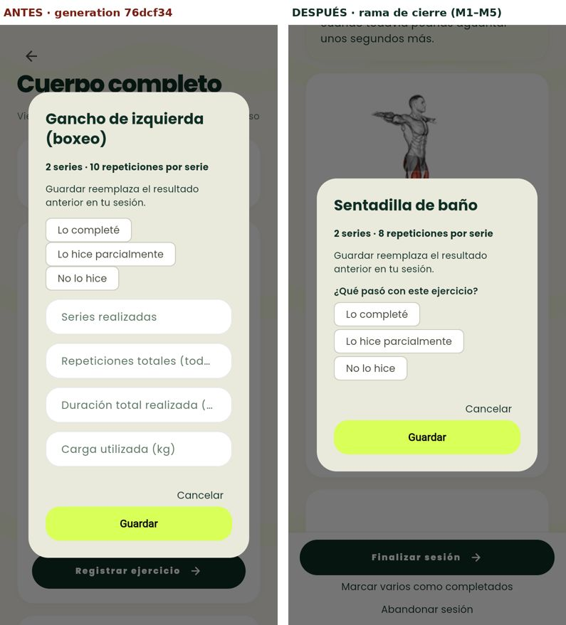
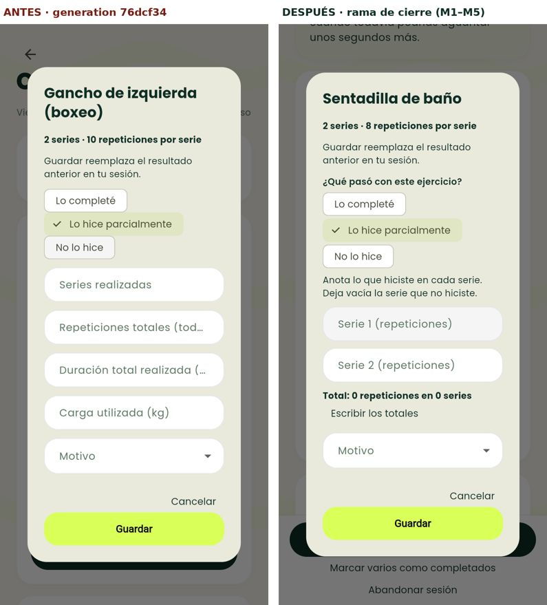
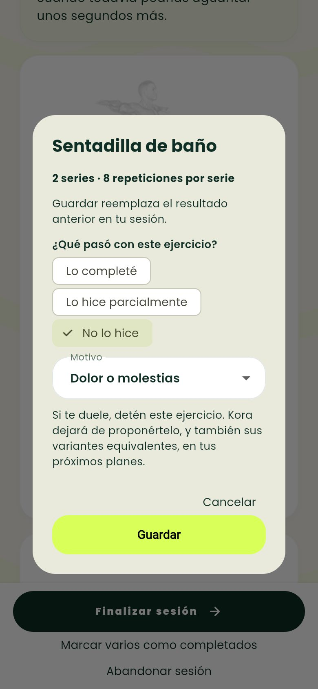

# 05 · Registro de entrenamientos y dolor (Mobile-M4)

PR Mobile-M4 · rama `claude/mobile-m4-registro-entrenamientos` · `24aa690` · base Mobile-M3. Pendientes: M-10, M-11,
M-12, M-13.

## 1. Compatibilidad D-M1, O20 y P1 (sin cambios)

- **Mismo contrato HTTP**: `PUT /sessions/{s}/exercises/{pe}` con `actualSets`, `actualRepsTotal`,
  `actualDurationSeconds`, `actualLoadKg`, `skipReason`; finalizar e informe retroactivo sin cambios.
- «Lo completé» sigue enviando `prescribedResult` (series × repeticiones o series × segundos).
- Mismas validaciones: sin volumen no hay parcial; un parcial con toda la prescripción pide «Lo completé».
- Cada resultado, también los del camino rápido, pasa por `send()`: confirma la rutina con el Backend (8 s máx.),
  retiene lo que O20 ya no permite y guarda en el teléfono (P1) lo que no se puede enviar.
- La adherencia la calcula el Backend; Mobile no calcula nada nuevo.

Las pruebas existentes de D-M1, O20 y P1 siguen en verde con **los mismos cuerpos esperados**; cinco de ellas escriben
ahora los totales con «Escribir los totales» (el campo dejó de estar a la vista por defecto).

## 2. M-13 · Acciones siempre visibles

Barra fija abajo, con los mismos textos que antes:

| Estado | Acción principal | Secundarias |
|---|---|---|
| Sin sesión, se puede empezar | «Comenzar entrenamiento» | «Ya lo hice · registrar entrenamiento», «Omitir entrenamiento» |
| Vencido o solo informable | «Ya lo hice · registrar entrenamiento» | «Omitir entrenamiento» si procede |
| Sesión en curso | «Finalizar sesión» | «Marcar varios como completados», «Abandonar sesión» |
| Registrando «Ya lo hice» | «Guardar entrenamiento» | «Marcar varios como completados», «Cancelar registro» |

Arriba, una línea explica los caminos: «Pulsa «Comenzar entrenamiento» para registrar en vivo, con cronómetro y
descansos. Si ya entrenaste, usa «Ya lo hice».» Durante la sesión: «Sesión en curso. Registra cada ejercicio al
terminarlo…». Continuar una sesión pendiente se hace abriendo esa rutina (la sesión vive en el Backend). P1 y los
borradores retroactivos (P3, sin implementar) mantienen su diferencia.

## 3. M-10 · Menos toques, sin registros automáticos

**Diálogo de un ejercicio:**

- Primero «¿Qué pasó con este ejercicio?»: no hay campos hasta elegir.
- «Lo completé»: «Se guardará lo indicado en tu plan: 2 series, 16 repeticiones en total.» (sin cajas de solo lectura).
- «Lo hice parcialmente»: **una casilla por serie** («Serie 1 (repeticiones)» o «(segundos)»), con «Total: N en M
  series» calculado; «Escribir los totales» para quien ya los sumó. Solo los campos del tipo de ejercicio; la carga solo
  con carga sugerida o equipo externo.
- «No lo hice»: motivo.

**«Marcar varios como completados»** (barra inferior): lista de los ejercicios aún sin resultado y no bloqueados por
O20, **ninguno marcado**; «Seleccionar todos»; el botón dice «Confirmo que hice completos N» y está deshabilitado sin
selección. El texto pide marcar solo los hechos completos y registrar uno por uno los demás. Se envían en orden por el
camino normal y se detiene en el primer problema (sin conexión, rutina cambiada), que queda en pantalla.

**Al finalizar:** «Lo que registraste: Completados: 6 · Parciales: 1 · No realizados: 1».

**Toques medidos en la prueba** (8 ejercicios, sesión completa): Comenzar (1) · Marcar varios (1) · Seleccionar
todos (1) · Confirmar (1) · Finalizar sesión (1) · esfuerzo (2) · Finalizar (1) = **8 toques** (antes ≈ 35). Ningún
ejercicio se marca por la persona.

## 4. M-11 · Esfuerzo y satisfacción

- Explicación fija: «Esfuerzo: cuánto te costó la sesión en conjunto, del 1 (lo mínimo) al 10 (lo máximo). No es dolor
  ni satisfacción: si algo te dolió, indícalo en ese ejercicio.» y «Satisfacción: cuánto te gustó la sesión, del 1 (lo
  mínimo) al 5 (lo máximo). Es opcional.»
- **Descripciones por nivel: preparadas y vacías** (`workouts/domain/rpe_scale.dart`), porque no hay descripciones
  aprobadas por el equipo del estudio. Cuando se aprueben se muestran como «5 · …» sin cambiar el valor enviado.
- Observaciones de la sesión: no existe el campo en el Backend; queda como decisión.

## 5. M-12 · Dolor en uno o dos toques

| Situación | Comportamiento |
|---|---|
| Ejercicio no registrado (en sesión o en «Ya lo hice») | «Tengo dolor o molestias» abre el diálogo con «No lo hice» + «Dolor o molestias» → «Guardar» (**2 toques**) |
| Sin sesión iniciada | El mismo botón pregunta antes «Comenzar sesión y registrar» o «Ya hice este entrenamiento» |
| Desde la ficha del ejercicio | Mismo botón; vuelve a la rutina con el diálogo abierto |
| Ya registrado como completado | «Paré antes de terminar por dolor» → parcial por dolor serie por serie; «Lo terminé, pero me dolió» → explica que todavía no se puede registrar (no hay contrato) y **no envía nada** |
| Sin conexión | Queda guardado en el teléfono (P1), nunca se envía sin confirmar la rutina |
| Rutina cambiada o restricción recién incorporada | El diálogo se abre con la rutina confirmada: si el ejercicio quedó bloqueado solo permite «No lo hice» |
| Ejercicio bloqueado (O20) | El botón no aparece (ya solo admite «No lo hice») |

Mobile no reactiva ni deduce equivalencias: eso sigue siendo del Backend.

## 6. Pruebas

`test/workout_logging_test.dart` (12) con un servidor simulado con estado: barra visible en 320 × 568; acciones en
sesión; **8 ejercicios en ≤ 12 toques** con cuerpos idénticos a «Lo completé» y la rutina confirmada antes de cada
envío; solo los marcados y nunca los bloqueados; sin conexión se detiene y guarda en P1; dolor en 2 toques; dolor tras
completado (las dos opciones); restricción incorporada mientras tanto; dolor desde la ficha; dolor sin conexión;
explicación de la escala y descripciones solo si están aprobadas.
`test/timed_exercise_results_test.dart` (+4): serie por serie produce el mismo cuerpo que los totales; carga solo donde
aplica; nada visible antes de elegir.

Contra el Backend local: las 3 pruebas en vivo de D-M1 (`timed_exercise_live_test`) siguen en verde sobre el código
integrado ([`evidencia/pruebas-en-vivo-cierre.txt`](evidencia/pruebas-en-vivo-cierre.txt)).
