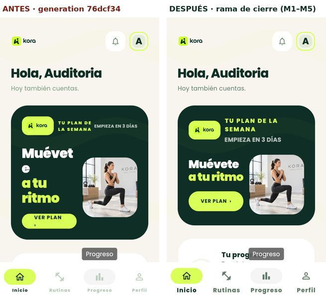
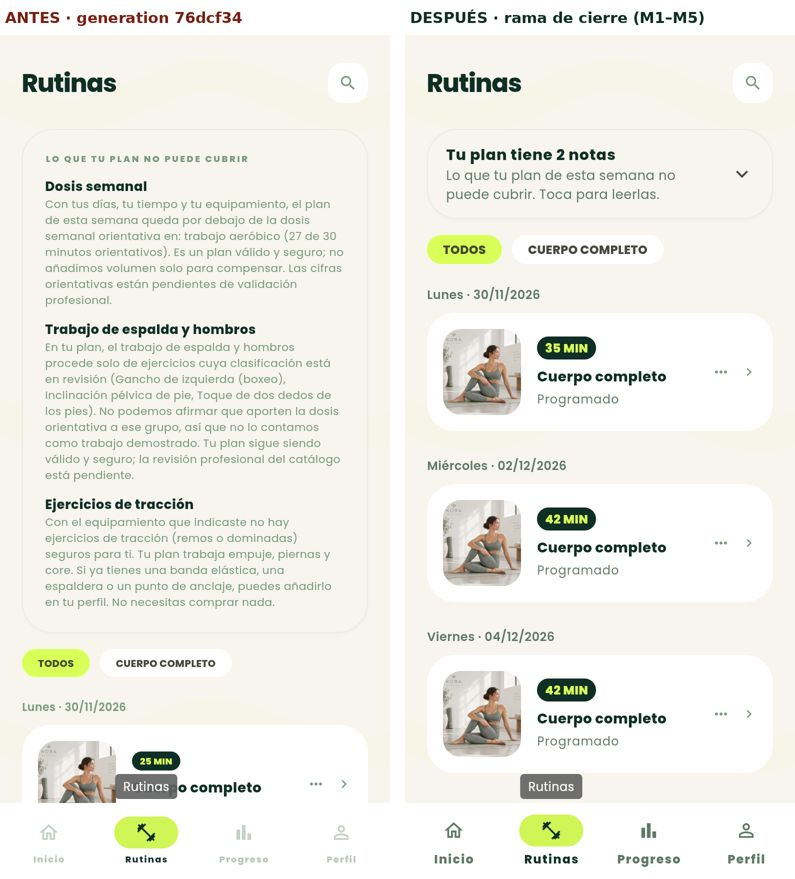
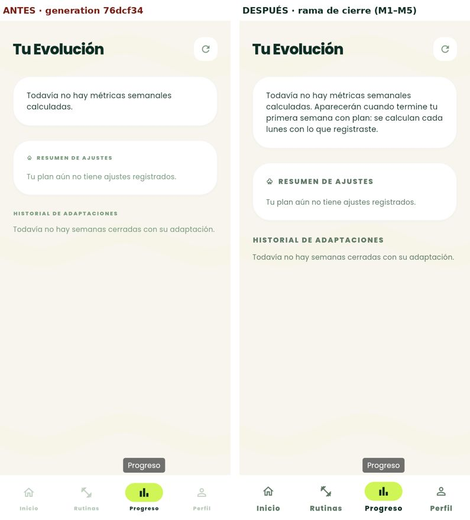
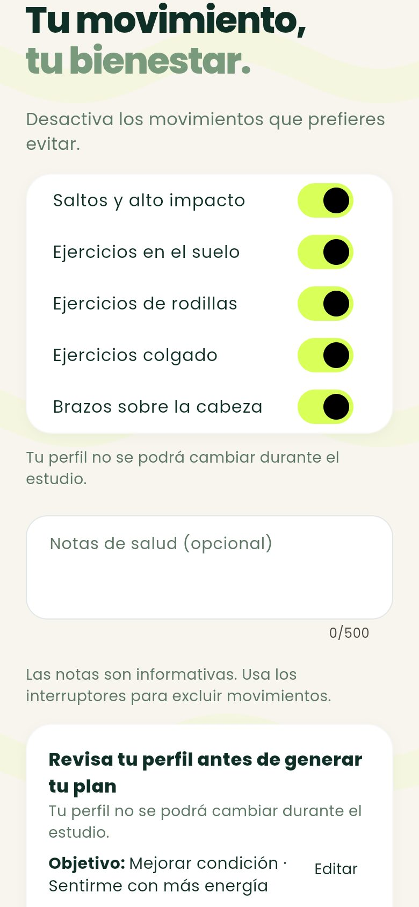

# 06 · Experiencia general, accesibilidad y navegación (Mobile-M5)

PR Mobile-M5 · rama `claude/mobile-m5-navegacion-accesibilidad` · `1a71644` · base Mobile-M4. Pendientes: M-14, M-15,
M-16, M-17, M-19, M-24, M-31 (parcial), M-32, M-35, M-38, M-40.

## 1. M-19 · Accesibilidad

| Problema de la auditoría | Cambio | Comprobación |
|---|---|---|
| 30 textos de 8–11,5 px | Mínimo 12 px en Inicio, Rutinas, Progreso, Perfil, etiquetas (`KoraLabel`), tema (`bodySmall`), recorrido y «Generando» | Prueba que recorre los párrafos pintados de las 4 pestañas en 320 × 568 con Poppins real: ninguno < 12 px |
| `Kora.sage` (3,11:1) en texto secundario | Texto secundario con `Kora.muted` (4,83:1 sobre blanco) | Prueba: ningún texto (no icono) en sage; contraste calculado |
| Barra inferior no seleccionada 1,78:1 | `Kora.muted` | — |
| «Muévete / a tu ritmo» partido a mitad de palabra | Titular que se reduce; «TU PLAN DE LA SEMANA» y la semana en dos líneas; «VER PLAN ›» se reduce si no cabe; tarjetas «Sesiones» y «Adaptación» apiladas por debajo de 360 px | Prueba genérica: **ningún párrafo más estrecho que su palabra más larga** en las 4 pestañas a 320 px. La primera captura de cierre en 320 px mostró «SEMA/NA» (provocado por el paso a 12 px); se corrigió y la prueba lo vigila |
| «VER PLAN» de 34 px | Objetivo de 48 dp | Prueba de tamaño |
| Botones de dolor y diálogos | Objetivos ≥ 48 dp | — |

Pendiente en teléfono: texto del sistema al 130–200 %, lector de pantalla TalkBack y orientación horizontal.
`Kora.muted` sobre el fondo marfil da 4,42:1: se usa solo en textos de 13 px o más.

## 2. M-14 · Rutinas

«Lo que tu plan no puede cubrir» queda plegado bajo «Tu plan tiene N notas · Lo que tu plan de esta semana no puede
cubrir. Toca para leerlas.» Las notas siguen disponibles; los avisos de dolor y seguridad O20 siguen arriba, abiertos.
El texto de cada nota es del Backend (sin cambios: su revisión es del Backend y del equipo del estudio).

## 3. M-15 · Progreso

| Antes | Después |
|---|---|
| «+5 pp» | «+5 puntos frente a la semana anterior» |
| «Cumplimiento en lo registrado: 60 %» | «De lo que registraste, cumpliste el 60 %» |
| «Calculado: 23/11/2026» | «Actualizado el 23/11/2026» |
| «Todavía no hay métricas semanales calculadas.» | + «Aparecerán cuando termine tu primera semana con plan: se calculan cada lunes con lo que registraste.» |
| Inicio: «Sin métricas calculadas» | «Tus datos aparecerán al cerrar tu primera semana» |

El porcentaje sigue siendo **exactamente** `weightedAdherencePct` del Backend. «Riesgo de abandono» se mantiene visible
por defecto para no cambiar la intervención sin acuerdo metodológico; `--dart-define=SHOW_DROPOUT_RISK=false` lo oculta.
**Decisión pendiente del equipo del estudio.**

## 4. M-16 · Recordatorios

Sin cambios de política: no se activan automáticamente (prohibido sin decisión). Revisión de lo existente, cubierta por
`reminders_test.dart`, `reminder_channel_test.dart` y `push_permission_test.dart`: permiso, configuración, programación
inexacta en la zona del usuario, cancelación al cerrar sesión y al cambiar de cuenta. **Nuevo (M-32):** un recordatorio
tocado con Kora cerrada abre Rutinas después de restaurar la sesión (`getNotificationAppLaunchDetails`). Solo probado con
pruebas unitarias: falta el teléfono.

## 5. M-17, M-24, M-40 · Seguridad y soporte

- **Retirada:** «Dejarás de participar en el estudio. Los datos que ya registraste no se borran. Desde ese momento Kora
  no prepara rutinas nuevas: podrás consultar tu historial y el plan de la semana en curso.» (comportamiento del Backend
  verificado).
- **Ayuda y soporte:** hoja con 8 preguntas sobre el uso de Kora (registrar, «Ya lo hice», parcial, dolor, esfuerzo,
  sin conexión, progreso, recordatorios) y el contacto del equipo. Sin `STUDY_CONTACT` dice «Escribe al equipo del
  estudio que te invitó…»: **no se inventó ningún correo ni teléfono**.
- **Mensaje de seguridad ante el dolor:** `PAIN_SAFETY_MESSAGE` lo muestra al informar dolor y en Ayuda; vacío por
  defecto. **No se redactó ninguna instrucción médica.**
- «Notificaciones» del Perfil y de la campana pasa a «Novedades de tu plan» (era el nombre de la hoja que abría).

## 6. M-38 y M-35 · Perfil inicial

- Antes de «Generar mi plan»: «Revisa tu perfil antes de generar tu plan» con objetivo, datos físicos, disponibilidad,
  equipo y movimientos a evitar, cada uno con «Editar» que lleva a su paso, y el aviso de que no podrá cambiarse.
- «Volver» en el paso 1 ya no abre un Inicio sin plan: pregunta «¿Salir de la configuración?» y permite cerrar sesión.

## 7. Pruebas

`test/navigation_accessibility_test.dart` (9, Poppins reales, 320 × 568 y 390 × 844) y
`test/onboarding_review_test.dart` (2). Actualizadas: `adherence_history_test` (textos), `backend_alignment_test`
(notas plegadas, textos), `ink_feedback_test` (Ayuda) y `reminder_channel_test` (llamada nueva del complemento).
