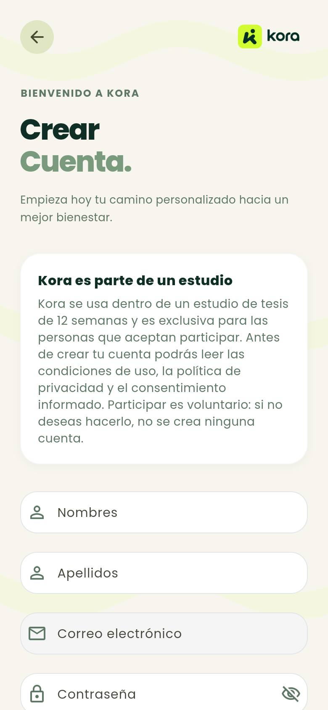
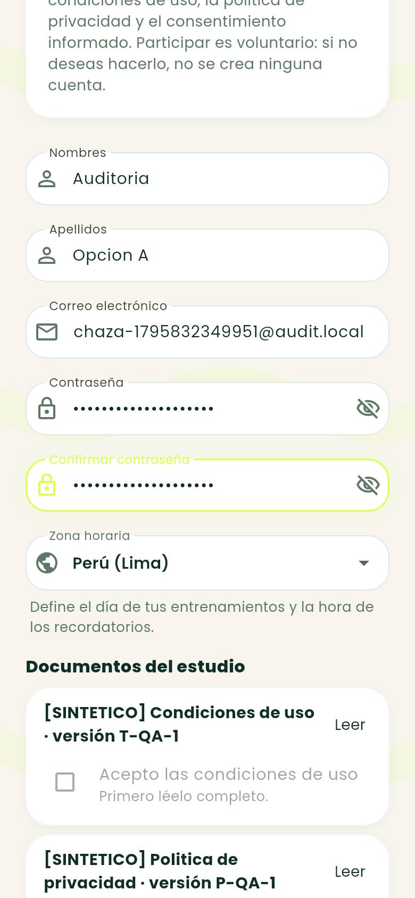
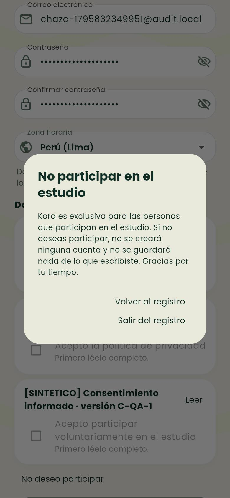
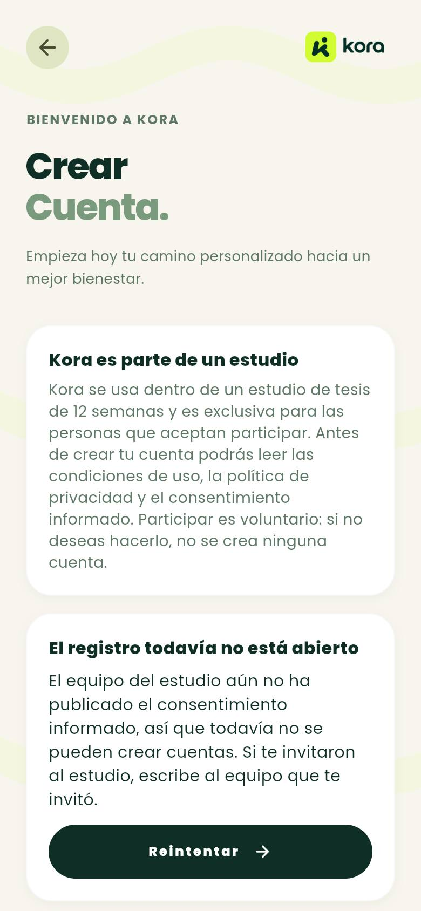
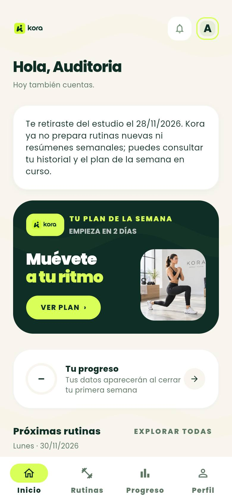

# 02 · Registro con la opción A (Mobile-C1, PR #33)

> **Revisión del 28/11/2026 (orden de merge):** ver [10](10_REVISION_FINAL_Y_BACKEND_96.md). El registro exige ahora
> los **tres** documentos publicados y Mobile usa los códigos estables de Backend #96. Backend #96 se fusionó
> (`434a9dc`) y después se fusionaron #33 (`ed11b5a`) y #34 (`9e9ebbc`).

**Decisión:** Kora es exclusiva para participantes del estudio de tesis. Ya no hay opción B en Mobile: se quitó
`PLANS_FOR_NON_PARTICIPANTS`.

## 1. Recorrido

> **Actualización del 28/11/2026 ([12](12_TERMINOS_SIMPLIFICADOS.md)):** ya no hay «Leer» ni «He leído el documento», y no hace falta llegar al final. Cada documento es una línea «☐ Acepto los Términos y condiciones». El nombre abre el documento, pero no marca la casilla, que se marca a mano. Un documento que no se puede mostrar sigue sin poder aceptarse. Las versiones, la opción A y lo que se envía al Backend no cambian.

| Paso | Qué ve la persona | Qué se envía |
|---|---|---|
| 1. Abrir Kora → «Comenzar ahora» | Registro | `GET /legal-documents` |
| 2. Conocer el estudio | Antes de escribir nada: «Kora es parte de un estudio… es exclusiva para las personas que aceptan participar… Participar es voluntario: si no deseas hacerlo, no se crea ninguna cuenta.» | — |
| 3–5. Documentos | Condiciones, privacidad y consentimiento informado, cada uno con «Leer». El lector exige llegar al final | El texto se descarga de la dirección que publica el Backend (sin JWT) |
| 6. Elegir | Una casilla por documento y otra para «Acepto participar voluntariamente en el estudio», **ninguna premarcada** y todas desactivadas hasta leer su documento. También «No deseo participar» | — |
| 7. Si acepta | «CREAR CUENTA» → se vuelven a consultar los documentos; si siguen iguales, se registra | `GET /legal-documents`, `POST /auth/register` con las cuatro versiones, `POST /auth/login` |
| 8. Si rechaza | «No participar en el estudio»: «Kora es exclusiva para las personas que participan en el estudio. Si no deseas participar, no se creará ninguna cuenta y no se guardará nada de lo que escribiste. Gracias por tu tiempo.» → «Salir del registro» borra lo escrito y vuelve a la bienvenida | **Nada** |
| 9. Perfil inicial | Como hasta ahora | — |
| 10. Primer plan | Solo si el Backend dice que la cuenta es participante activa (`planIneligibility`) | Generación asíncrona, como hasta ahora |

## 2. Cuándo está abierto el registro

Solo si el Backend publica **los tres documentos**: condiciones de uso, política de privacidad y consentimiento informado (revisión del 28/11/2026; antes bastaba el consentimiento).

**Por qué:** la orden exige no crear una cuenta como participante sin una aceptación válida. Sin documento publicado, el
Backend registraría la participación con la evidencia `CASILLA_SIN_DOCUMENTO_APROBADO`, que el propio Backend declara
«no es prueba válida de un consentimiento informado». Por eso, sin el consentimiento publicado, la app no ofrece el
formulario:

> **El registro todavía no está abierto.** El equipo del estudio aún no ha publicado el consentimiento informado, así
> que todavía no se pueden crear cuentas. Si te invitaron al estudio, escribe al equipo que te invitó.

Ese es el estado actual de un Backend sin documentos configurados, como hoy (comprobado en vivo, I-02). Si la consulta
falla, la app lo explica y ofrece «Reintentar»: nunca deja registrarse sin comprobar los documentos.

**El registro de participantes se abre solo** cuando el Backend publica los documentos, y publicarlos exige su
referencia de aprobación (`approval-reference`). Mobile no tiene ninguna bandera propia para abrirlo.

## 3. Cuenta creada sin participación (por otra vía) y persona retirada

| Caso | Comportamiento | Comprobado |
|---|---|---|
| Cuenta sin participación (solo posible por la API; la app no ofrece ese camino) | «Por ahora no hay una rutina para ti»: «Kora es exclusiva para las personas que participan en el estudio, y tu cuenta no está inscrita como participante.» Contacto, «Volver a comprobar», «Cerrar sesión». Ninguna petición de generación | En vivo I-10 y en la app (C1-08) |
| Retirada **sin** plan | La misma pantalla, con la fecha de la retirada; sin «Reintentar generación» ni error genérico; ninguna generación | En vivo I-12 y en la app (C1-09) |
| Retirada **con** plan | Inicio con el aviso: «Te retiraste del estudio el dd/mm/aaaa. Kora ya no prepara rutinas nuevas ni resúmenes semanales; puedes consultar tu historial y el plan de la semana en curso.» Perfil › Cuenta: «Te retiraste del estudio el…». Ninguna petición de generación | Prueba y app (C1-12b) |
| Reactivación | La app nunca reactiva la participación; el Backend rechaza aceptar `STUDY_PARTICIPATION` fuera del registro («la reincorporación la gestiona el equipo del estudio») | En vivo I-12 |

Antes de este cambio, una persona retirada con plan veía el Inicio sin ninguna señal de su estado
([`C1-12a`](capturas/C1-12a-retirada-con-plan-inicio-ANTES-del-aviso.jpg)). Sigue apareciendo la tarjeta «Tus datos
aparecerán al cerrar tu primera semana», que para una persona retirada es inexacta; queda anotado como detalle P2.

## 4. Lo que no se cambió

Autenticación, sesión persistente, perfil inicial, generación asíncrona, ficha de ejercicios, registro rápido, D-M1,
O20, P1, P2, Firebase, recuperación, progreso, adherencia y accesibilidad.

## 5. Para el Backend (no se modificó desde Mobile)

`POST /auth/register` sigue aceptando `acceptsStudyParticipation=false` (comprobado en I-10). Con la opción A, el Backend
podría rechazar esas altas o marcarlas para el equipo. Mientras tanto, la app no ofrece ese camino y esas cuentas no
reciben plan.
