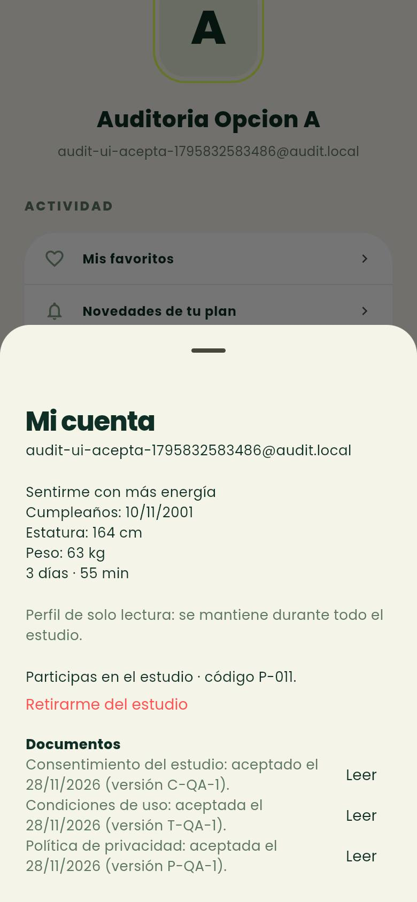

# 03 · Documentos y consentimientos versionados (Mobile-C1, PR #33)

> **Revisión del 28/11/2026 (orden de merge):** ver [10](10_REVISION_FINAL_Y_BACKEND_96.md). El registro exige ahora
> los **tres** documentos publicados; Mobile usa los códigos estables de Backend #96; las PR siguen **sin fusionar**
> porque Backend #96 no está integrado.

## 1. Consulta de documentos (contrato real)

`GET /api/v1/legal-documents`: público, sin JWT, `Cache-Control: no-cache`. Respuesta real del Backend `41c498a`, con
los documentos sintéticos de la prueba:

```json
{"enforcedOnSignup": true, "privacyRecord": "ACEPTACION", "documents": [
  {"type": "STUDY_PARTICIPATION", "version": "C-QA-1", "title": "[SINTETICO] Consentimiento informado",
   "url": "https://localhost:8443/consentimiento-C-QA-1.txt", "status": "PUBLISHED", "effectiveFrom": "2026-11-01"}, …]}
```

| Campo | Uso en Mobile (`PublishedDocuments`, `LegalDocument`) |
|---|---|
| `type` | `TERMS_OF_SERVICE`, `PRIVACY_POLICY` o `STUDY_PARTICIPATION`; cualquier otro se ignora |
| `version` | Exactamente lo que se envía de vuelta en el registro |
| `title` | Título en el registro y en el lector; si viene vacío, uno genérico por tipo |
| `url` | Dirección del texto completo, que se lee dentro de la app (descarga sin JWT; solo `https` en compilaciones de producción) |
| `status` | Solo cuentan los `PUBLISHED`; el Backend ya no lista borradores |
| `effectiveFrom` | Se conserva; el Backend solo lista los ya vigentes |
| `enforcedOnSignup` | Informativo: la app exige lo mismo con o sin la exigencia (todo documento publicado se lee y se acepta) |
| `privacyRecord` | `ACEPTACION` → «Acepto la política de privacidad»; `CONSTANCIA` → «He leído la política de privacidad» |

Lista vacía: no hay documentos aprobados. Mobile no simula ninguna aceptación y el registro queda cerrado
([02](02_REGISTRO_OPCION_A.md) §2). Error de red: mensaje y «Reintentar»; no hay reintento automático.

**Una dirección no equivale a una aceptación.** La aceptación es la casilla, que se activa tras leer el documento
hasta el final; la versión enviada es la del documento leído.

## 2. Lectura

El lector descarga el texto o HTML simple de la dirección, lo muestra completo con su versión y solo cuenta como leído
cuando se llega al final («He leído el documento»). Salir antes no cuenta.

**Contenido:** Mobile no redacta ningún texto legal. Los documentos que aparecen en esta evidencia son **sintéticos**:
cada uno empieza por «DOCUMENTO SINTETICO DE PRUEBA - NO APROBADO». El consentimiento sintético solo enumera, sin
contenido, los apartados que el texto aprobado deberá cubrir: finalidad, qué implica participar, duración, información
recopilada, uso de los datos y de la IA, riesgos, retirada y contacto
([`evidencia/documentos_sinteticos/`](evidencia/documentos_sinteticos/)).

## 3. Registro de la aceptación

`POST /auth/register` (`RegisterRequest`):

| Campo | Valor |
|---|---|
| `acceptsStudyParticipation` | `true` (con la opción A el registro solo se envía si la persona acepta) |
| `acceptedTermsVersion` | Versión del documento de condiciones leído, si está publicado |
| `acceptedPrivacyVersion` | Ídem, política de privacidad |
| `acceptedStudyConsentVersion` | **Nuevo.** Versión del consentimiento informado leído (siempre, porque sin él el registro está cerrado) |

Ninguna versión sale de una variable de compilación: se quitaron `TERMS_VERSION`, `PRIVACY_VERSION`,
`STUDY_CONSENT_URL` y `STUDY_CONSENT_VERSION`. Mobile nunca envía `MVP-1.0`; esa etiqueta solo la usa el Backend cuando
no hay documento, y ese caso ya no llega desde la app.

Evidencia en PostgreSQL de pruebas (I-09): las tres filas con la versión leída y `CASILLA_REGISTRO`.

## 4. Cambios de versión

| Momento | Comportamiento |
|---|---|
| Entre la lectura y «CREAR CUENTA» | Justo antes de enviar, la app vuelve a consultar `GET /legal-documents`. Si algo cambió (versión nueva, documento retirado o añadido): **no envía nada**, muestra «Los documentos cambiaron… Tu cuenta no se creó», recarga los documentos vigentes y desmarca todo |
| El Backend rechaza (carrera) | Los 422 de documentos («no es la vigente», «no hay una version aprobada», «tienes que aceptar») reciben el mismo tratamiento. El Backend valida antes de crear la cuenta, así que no quedan cuentas a medias (comprobado: el login con ese correo da 401) |
| Consentimiento retirado de la publicación | «Uno de los documentos ya no está publicado…» |

Probado en la app real reiniciando el Backend con `T-QA-2` mientras el formulario estaba abierto: no se envió la versión
anterior, se mostró la vigente y, al aceptarla, el registro envió `T-QA-2` ([`C1-06`](capturas/C1-06-documentos-cambiaron.jpg)).

## 5. Historial en Perfil

Perfil › Cuenta › «Documentos»: una línea por tipo, con los datos de `GET /users/me/consents` (`grantedAt`,
`affirmativeAction`, `documentVersion`, `withdrawnAt`). Nunca muestra una aceptación que no esté en el servidor.

| Caso | Texto |
|---|---|
| Consentimiento aceptado con su documento | «Consentimiento del estudio: aceptado el dd/mm/aaaa (versión C-QA-1).» + «Leer» si esa versión sigue publicada |
| Participación sin documento aprobado (cuentas anteriores) | «Participación en el estudio registrada el … sin un consentimiento informado publicado (etiqueta MVP-1.0, no es un documento aprobado).» |
| Condiciones aceptadas | «Condiciones de uso: aceptada el … (versión T-QA-1).» |
| Privacidad con constancia | «Política de privacidad: informada el … (versión …).» |
| Versión aceptada antigua | «…aceptaste la versión X el …; la vigente es la Y.» |
| Nada registrado | «…todavía sin versión publicada» o «pendiente de aceptar (versión …)» |



La pantalla de documentos nuevos tras iniciar sesión (`ConsentPage`) toma también la dirección y el título de
`GET /legal-documents`, y adapta el texto de la casilla de privacidad a `privacyRecord`.

## 6. Activación

Estado: **PREPARADO SIN ACTIVAR**, y la activación está **BLOQUEADA POR APROBACIÓN**. Mobile ya envía los cuatro
campos y pasa las pruebas de contrato contra el Backend real. Para activar el registro definitivo con consentimientos
obligatorios falta, en este orden:

1. **Equipo del estudio / comité:** textos aprobados de condiciones, privacidad y consentimiento informado.
2. **Backend:** publicar los tres documentos (`fitsense.legal-documents.items[…]` con `status=PUBLISHED`,
   `approval-reference`, `effective-from`, `url` https) y decidir `fitsense.consent.privacy-record`.
3. **Backend + equipo:** encender `fitsense.consent.enforce-on-signup` en el entorno de pruebas, y repetir I-01…I-09 y
   la comprobación del historial en su PostgreSQL.
4. **Equipo:** aprobar la activación conjunta y repetirla en preproducción.

Mobile no necesita una compilación distinta: la app lee lo publicado. La exigencia se forzó **solo** en la instancia
local de pruebas; no se activó en ningún otro entorno.
