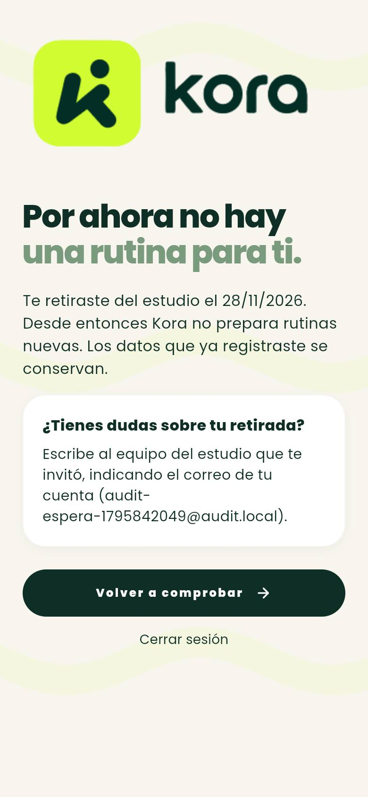

# 10 · Revisión final de #33, #34 y #35 e integración con Backend #96

Orden: «Revisión, integración definitiva de consentimientos y merge de PR pendientes». Fecha: 28/11/2026.

## 1. Estado de partida y bloqueo del merge

| | |
|---|---|
| Mobile `generation` | `1cd9f97b4566de90ddcede2c46ff4da5714edebe` (con la #32) |
| `main` | `3a4e26d1fed5170c6790cd05c9129f58ce88b4d0`, sin cambios |
| Backend `generation` | `41c498a`, sin cambios |
| **Backend #96** | Abierta al empezar (cabeceras `035e961` y `401ca56`, las dos probadas); **fusionada durante la revisión** en `generation` **`434a9dc05b3479be88eabba9e23658d2ecb38052`**, con el mismo código que `401ca56` |

La orden fija el orden del merge: **primero Backend #96 integrado y su contrato verificado**, luego Mobile #33, #34 y
#35. Mientras #96 estuvo abierta no se fusionó nada; se hicieron la revisión, las correcciones, la regresión combinada y
las pruebas contra su cabecera. Cuando #96 se fusionó, el contrato crítico se repitió contra el Backend `434a9dc`
compilado en local (11/11, [`evidencia/backend_96/contrato-en-vivo-96.txt`](evidencia/backend_96/contrato-en-vivo-96.txt)).
Solo entonces se fusionaron las PR de Mobile, una por una:

| PR | Merge (SHA completo) | `flutter test` en `generation` | CI de `generation` |
|---|---|---|---|
| [#33](https://github.com/Fitsense-Real/MobileApp/pull/33) Mobile-C1 (`d6f3471`) | `ed11b5aa4a0d8809392c6ca31d06960db07d9ae6` | 520 ✓ · 0 ✗ · 44 | [verify ✓](https://github.com/Fitsense-Real/MobileApp/actions/runs/46110773059) |
| [#34](https://github.com/Fitsense-Real/MobileApp/pull/34) Mobile-C3 (`8af00d4`) | `9e9ebbc161f232fb35a6e17484d715cd574c7aa5` | 522 ✓ · 0 ✗ · 44 | ver la PR #35 |
| [#35](https://github.com/Fitsense-Real/MobileApp/pull/35) Mobile-C4 (esta documentación) | se registra en el informe final | — | — |

## 2. Qué trae Backend #96 y cómo responde Mobile

| Cambio de #96 | Mobile |
|---|---|
| 422 con un código estable en `details[0]`: `CONSENTIMIENTO_REQUERIDO`, `PARTICIPACION_REQUERIDA`, `DOCUMENTO_NO_PUBLICADO`, `VERSION_NO_VIGENTE`, `VERSION_SIN_PARTICIPACION` | El registro decide por el código (el texto queda como respaldo para versiones anteriores del Backend); el código nunca se muestra |
| Registro definitivo: sin aceptar participar no hay cuenta (`PARTICIPACION_REQUERIDA`) | La app nunca envía `acceptsStudyParticipation=false` |
| Solo un consentimiento `CASILLA_REGISTRO` da derecho a planes | La app envía siempre la versión leída, que el Backend registra como `CASILLA_REGISTRO` (I-09) |
| `PARTICIPACION_NO_VIGENTE` al pedir o publicar un plan | Relee la cuenta y muestra su estado real; nunca vuelve a pedir |
| La elegibilidad se comprueba **al publicar**, con la fila bloqueada | Probado con un proveedor de IA simulado (§5) |
| `requiredForSignup` por documento en `GET /legal-documents` | Compatible: Mobile exige siempre los tres documentos |
| `PERFIL_INCOMPLETO` como código | Compatible: se muestra el mensaje del Backend |

## 3. Correcciones en #33 (Mobile-C1)

| Hallazgo de la orden o de la revisión | Corrección | Prueba |
|---|---|---|
| El registro se abría con solo el consentimiento | Ahora exige **los tres** documentos (condiciones, privacidad y consentimiento); si falta alguno queda cerrado y dice cuál | `registration_consents_test` (solo el consentimiento, sin consentimiento, sin privacidad, modelo `missing`) |
| Un documento cuya dirección falla no debe contar como leído | El lector muestra el error y «Reintentar»; la casilla sigue desactivada | «a document that cannot be opened…» |
| Códigos de #96 | `apiErrorCode()`, `AuthState.errorCode`, `isDocumentProblem(…, code:)` | «422 with the stable code…», mensajes 422 |
| Registro duplicado, respuesta inesperada, 429 sin `Retry-After` | Mensaje claro; se conservan el formulario y las aceptaciones; sin inventar un tiempo de espera | 3 pruebas nuevas |
| «Tus datos aparecerán al cerrar tu primera semana» para una persona retirada | «Sin resúmenes semanales desde tu retirada» (también en Progreso sin métricas). No cambia ningún cálculo | `navigation_accessibility_test` |
| Retirada durante la generación | `PARTICIPACION_NO_VIGENTE`, o una operación cerrada sin reintento → relee la cuenta → estado de retirada | `first_plan_participation_test` |
| 409 (I-14) | «Tu plan cambió»: explica el cambio, no muestra nada obsoleto, no reintenta solo y lleva al plan actual | `first_plan_participation_test` (**servidor simulado**) |
| **Encontrado en la app real:** con la retirada antes de la petición, se pedía la generación dos veces | Tras `PARTICIPACION_NO_VIGENTE`, `start()` no vuelve a pedir | Prueba nueva: 3 peticiones con el código anterior, 1 ahora |

Cabecera de #33: `d6f3471`.

## 4. Revisión de #34 (Mobile-C3)

- **Mecanismo:** `watchAccount(ref)`. Sin cuenta no se envía nada y se devuelve vacío; con otra cuenta se recarga con su
  token. No toca JWT, `logout()`, el almacenamiento ni P1.
- **Las dos pruebas adaptadas** (`adaptation_history`, `pain_o20`; ocho casos) solo añaden una sesión iniciada:
  - el usuario simulado es un participante autenticado, el estado real de esas pantallas;
  - no se quitó ninguna comprobación;
  - la prueba «cierre de sesión y nuevo inicio» sigue con su propia sesión;
  - las pantallas de acceso no usan esos datos y siguen sin sesión (`auth_social_cleanup_test`, `edge_to_edge_test`).
- **Prueba inversa conservada:** `logout_requests_test` falla con el código anterior (peticiones tardías) y pasa con la
  corrección.
- **Nuevo:** cambio rápido de cuenta con solicitudes en curso (respuestas lentas). Solo quedan los datos de la cuenta
  nueva, con su token.
- **App real contra #96:** cerrar sesión y entrar con otra cuenta → **0 respuestas 401**.
- **Cerrar Kora durante una solicitud y reabrir:** los datos de pantalla viven en memoria y se recargan al restaurar la
  sesión; P1 conserva lo pendiente (pruebas existentes). En el teléfono, filas D7–D8 y F6 de la matriz.

Cabecera de #34: `8af00d4`.

## 5. Retirada durante la generación (Backend #96)

El Backend se arrancó con `fitsense.ai.base-url` apuntando a un **proveedor simulado local**
([`evidencia/arnes/ia_simulada.py`](evidencia/arnes/ia_simulada.py)), que responde a los 20 s con 503. Nunca se llamó a
Replicate. Hubo que usar el perfil por defecto porque `local-dev` prohíbe encender la IA. Al fallar la IA, el Backend
cae al motor de reglas e intenta publicar: ahí actúa la comprobación de #96.

| Paso | Resultado |
|---|---|
| 1–3. Participante sintético, perfil, petición | 202 → `PROCESSING` |
| 4–5. IA simulada lenta; retirada antes de publicar | `POST /users/me/withdraw` 200 durante la espera |
| 6–7. La operación termina; ¿se publica? | `FAILED NO_GENERABLE`, `planId=null`, `GET /plan/current` → 404. Log: «FAILED… Tu cuenta no tiene una participacion activa…» justo después de la respuesta de la IA |
| 8–9. Mobile (app real) | Pasa sola de la espera a «Te retiraste del estudio el 28/11/2026…», sin «Algo salió mal» ni «Intentar de nuevo» |
| 10. ¿Pide otra generación? | **No**: una sola petición en los dos órdenes posibles (retirada después de la petición → 202; antes → 422) |

Evidencia: [`evidencia/backend_96/retirada-durante-generacion.txt`](evidencia/backend_96/retirada-durante-generacion.txt),
[`capturas/backend_96/`](capturas/backend_96/).

## 6. I-01 a I-16 contra Backend #96

| Caso | Resultado contra #96 |
|---|---|
| I-01 | ✓ Tres documentos, versiones y `requiredForSignup=true` |
| I-02 | ✓ Sin documentos: registro cerrado; ningún POST |
| I-03 | ✓ «No deseo participar» sin ninguna petición |
| I-04 | ✓ 201 con las cuatro versiones (app real y API) |
| I-05, I-06, I-08 | ✓ 422 `VERSION_NO_VIGENTE`; sin cuenta |
| I-07 | ✓ 422 `CONSENTIMIENTO_REQUERIDO`; sin cuenta |
| I-09 | ✓ Historial con `CASILLA_REGISTRO` y las versiones leídas; Perfil › Cuenta |
| I-10 | ✓ **Cambio con #96:** sin participar ya no se crea la cuenta (422 `PARTICIPACION_REQUERIDA`) |
| I-11 | ✓ Generación asíncrona por el motor de reglas (`COMPLETED`); también la síncrona del primer plan con IA simulada (respaldo por reglas) |
| I-12 | ✓ 422 `PARTICIPACION_NO_VIGENTE`; consentimiento retirado; la app muestra la retirada y no pide generación; retirada durante la generación (§5) |
| I-13 | ✓ 429. **Android/nativo:** «…Podrás intentarlo de nuevo en 15 minutos.» (lee `Retry-After`). **Web:** el navegador no deja leer `Retry-After` porque el Backend no lo expone por CORS (no declara `exposedHeaders`); la app muestra el mensaje del Backend sin prometer un tiempo |
| I-14 | **Real:** idempotente, el plan no cambia. **409:** solo con un **servidor simulado** (pruebas de #33). No se consiguió un 409 real en local |
| I-15 | ✓ Sin conexión al crear: mensaje y formulario intacto; al reintentar, una sola cuenta (comprobado en la base) |
| I-16 | ✓ Cambio de cuenta sin datos de la anterior; 0 respuestas 401 |

Regresión en vivo con #96 (exigencia apagada, pruebas sintéticas): D-M1 3/3, O20 1/1 + 4/4, push 1/1 + 3/3 y
recuperación igual que antes.

## 7. Regresión combinada

Rama temporal local: `generation` `1cd9f97` + #33 `d6f3471` + #34 `8af00d4` + #35, sin conflictos.

| | Aprobadas | Fallidas | Omitidas |
|---|---|---|---|
| `generation` (referencia) | 494 | 0 | 31 |
| #33 sola | 520 | 0 | 44 (31 + 13 en vivo) |
| #34 sola | 496 | 0 | 31 |
| **#33 + #34 + #35** | **522** | **0** | **44** |

522 = 494 + 26 de #33 + 2 de #34. Omitidas: las 31 de siempre + 12 en vivo de consentimientos + 1 en vivo de retirada
(solo corren con Backend). Ninguna prueba se quitó ni se desactivó. `flutter analyze`: sin incidencias.

## 8. Lo que queda

1. Tras fusionar #35: `flutter analyze` y `flutter test` sobre el `generation` final, y comprobar la CI.
2. **Backend (opcional):** exponer `Retry-After` por CORS para la versión web.
4. Lo demás sigue igual que en [09](09_PENDIENTES_PARA_PREPRODUCCION.md): textos aprobados, correo real, matriz Android
   (ninguna prueba física ejecutada).
