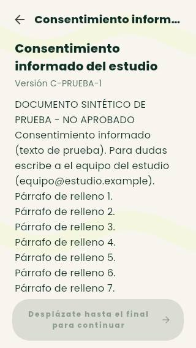
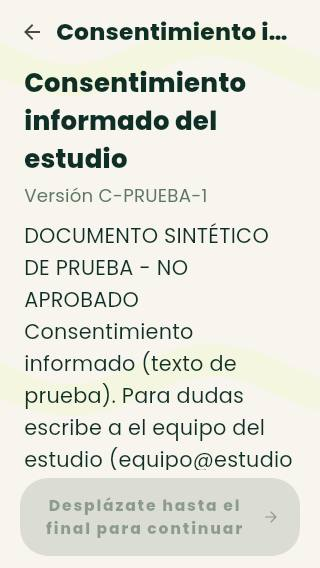
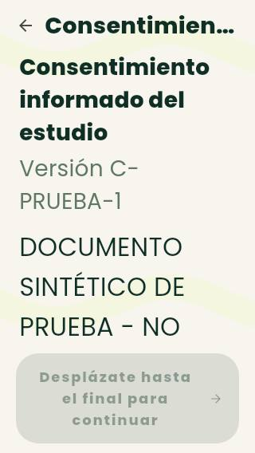
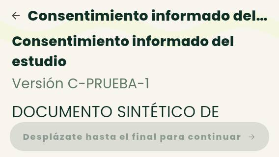

# 11 · Documentos visualizados en Flutter (PR #36)

Fecha: 28/11/2026.

| | |
|---|---|
| Mobile `generation` de partida | `ba55e1dd55f3a9cca2162db6778c1154c815b3b2` (#33, #34 y #35 fusionadas) |
| PR | [Fitsense-Real/MobileApp#36](https://github.com/Fitsense-Real/MobileApp/pull/36), rama `claude/mobile-documentos-formato-enlaces` |
| Backend usado en las pruebas | `generation` **`9aa7abfe800492940ff2e99970ded462e1c48db7`** (#96–#98 y #100; ninguno cambia el registro ni los documentos), en local con una base aislada. **Nunca la base Neon real** |
| Contrato del Backend | `docs/FitSense/integracion_final_estudio/09_CONTRATO_MOBILE.md` (Backend #100), sin cambios |
| SHA final de Mobile | El merge de la #36 se registra en el informe de cierre de la orden (se conoce después de fusionar) |

Arquitectura sin cambios: Flutter → Spring Boot → PostgreSQL (Neon). Mobile no se conecta a la base y la #36 no toca la
URL del Backend, la autenticación, la generación ni las reglas de entrenamiento.

## 1. Flujo del registro (sin cambios)

1. Datos de la cuenta.
2. Bajo «Documentos del estudio», cada documento (condiciones, política de privacidad y consentimiento informado) tiene
   «Leer».
3. «Leer» abre el documento dentro de Kora.
4. «He leído el documento» o «Volver» regresan al formulario.
5. Se marca voluntariamente la casilla de ese documento, que empieza desmarcada y solo se activa tras leerlo.
6. «CREAR CUENTA» se acepta solo con los tres documentos leídos y aceptados y con la participación aceptada.

La opción A no cambia: el consentimiento informado tiene su propia casilla, «No deseo participar» no crea ninguna
cuenta, el registro sigue cerrado sin documentos aprobados y se envían las cuatro versiones leídas, comprobadas justo
antes de enviar.

## 2. Formatos admitidos

**Decisión del 28/11/2026:** los documentos se publicarán en **HTML** para verse en Flutter. No se añade un visor de
PDF.

| Formato | Tratamiento |
|---|---|
| HTML (`text/html`, `application/xhtml+xml`) | Se muestra como texto legible: párrafos, títulos y listas con «•», entidades traducidas (§3) y enlaces con su destino (§4). Scripts, estilos, iframes y atributos activos **no se ejecutan ni se muestran**: el lector no interpreta HTML, solo extrae su texto |
| Texto plano (`text/plain`) | Tal cual |
| Sin `Content-Type` | Se decide por el contenido |
| PDF, imágenes o binarios | **Bloqueados**: «El documento no está en un formato que Kora pueda mostrar (texto o HTML). Contacta al equipo del estudio.», con «Reintentar» y **sin** «He leído el documento». No se puede aceptar y el formulario no pierde lo escrito ni las otras aceptaciones |
| PDF anunciado como `text/html` o `text/plain` | También bloqueado (se reconoce la firma `%PDF`) |
| `Content-Type` repetido por el servidor | Se usa el último; el documento se abre |

Recomendación para el equipo: HTML sencillo en UTF-8, servido por `https` con un certificado válido.

## 3. Cambios de la PR #36

| # | Defecto (reproducido antes de corregirlo) | Corrección |
|---|---|---|
| D-1 | Un PDF se mostraba como caracteres ilegibles y se podía «leer» y aceptar | Bloqueado (§2) |
| D-2 | Los enlaces perdían su destino (desaparecían el correo y la página de contacto) | «el equipo del estudio (equipo@estudio.example)». Se puede copiar; no se abre con un toque (sin `url_launcher`) |
| D-3 | A 320 × 568 con texto al 200 %, el lector se desbordaba 173 px | Barra fija compacta; el título completo y la versión pasan al inicio del texto |
| D-4 (revisión) | Las entidades HTML numéricas y muchas con nombre no se traducían: «Informaci&amp;#243;n», «&amp;iquest;Dudas?»; y «&amp;amp;lt;» se decodificaba dos veces | Una sola pasada: numéricas (`&#243;`, `&#xE9;`) y las habituales en textos legales en español (mayúsculas acentuadas, ¿ ¡ « » — comillas…). Las desconocidas se conservan |
| D-5 (revisión) | Sin desbordarse, el lector era poco legible con texto grande: a 320 px al 200 % el título partía una palabra («Consentimie / nto») y apenas quedaba espacio para el texto; en horizontal al 200 % solo quedaban 84 px de 320 | El **texto del documento sigue creciendo hasta el 200 %**. Las partes fijas crecen menos: barra hasta el 160 % (título en una línea), título hasta el 140 % y botón hasta el 150 %. Ninguna palabra del título se parte y el texto se ve desde la primera pantalla. En horizontal al 200 %: 136 px de texto (antes 84) |

**Archivos:** `consents/data/document_text_repository.dart`, `consents/presentation/document_reader_page.dart`,
`test/document_reader_test.dart` y esta documentación. Nada más.

## 4. Pantallas pequeñas: evidencia

Capturas renderizadas por Flutter con las fuentes de la app
([`evidencia/arnes/capturas_lector_pantalla_pequena.dart.txt`](evidencia/arnes/capturas_lector_pantalla_pequena.dart.txt)):

| Tamaño y texto | Captura |
|---|---|
| 320 × 568, 100 % |  |
| 320 × 568, 130 % |  |
| 320 × 568, 200 % |  |
| 568 × 320 (horizontal), 200 % |  |

En la app real (navegador, 390 × 844):
- política de privacidad con enlaces ([D-02](capturas/documentos_flutter/D-02-documento-con-enlaces.jpg));
- consentimiento con entidades, `<style>` y `<script>`, que no se muestran ni se ejecutan
  ([D-07](capturas/documentos_flutter/D-07-consentimiento-html-entidades-script.jpg));
- PDF bloqueado ([D-01](capturas/documentos_flutter/D-01-documento-pdf.jpg)).

## 5. Pruebas automatizadas

`test/document_reader_test.dart`: **20 pruebas**, 7 de la primera versión y 13 de la revisión.

| Grupo | Pruebas |
|---|---|
| Formatos | Texto y HTML (también con `Content-Type` repetido o ausente); PDF, binario e imagen bloqueados; PDF anunciado como HTML o texto bloqueado |
| HTML | Enlaces con destino (`mailto:`, `https:`, `#`, `javascript:`); nada activo (scripts, estilos, iframes, atributos, `javascript:`); entidades |
| Lector | PDF: mensaje, «Reintentar» y vuelve como no leído. **Matriz 320 × 568 y 568 × 320 al 100/130/200 %:** sin desbordes, título sin palabras partidas (con las fuentes reales), versión, «Volver» alcanzable, hasta el final y vuelve como leído |
| Registro | 320 px al 200 % y horizontal al 100/130/200 %: todos los documentos, casillas y «No deseo participar» alcanzables. Documento PDF: el formulario conserva lo escrito y las otras aceptaciones, y el PDF no se puede aceptar. Aceptaciones tras girar el teléfono y desplazarse |

La prueba del título falla con el lector anterior (título de 340 px en 272 px a 320 px y 200 %) y pasa con el nuevo.

**Resultado:** `flutter analyze` sin incidencias; `flutter test` **542 aprobadas · 0 fallidas · 44 omitidas** (522 de
`generation` + 20). Ninguna prueba anterior se modificó.

Aceptación (pruebas de registro, sin cambios): casilla desmarcada al empezar; no se acepta un documento sin abrir ni uno
que falló al cargar; la versión enviada es la mostrada; un cambio de versión obliga a revisarlo de nuevo; consentimientos
separados; las aceptaciones se conservan al girar el teléfono.

## 6. Pruebas de integración (Backend local `9aa7abf`)

Evidencia: [`evidencia/documentos_flutter/recorridos-pr36-9aa7abf.txt`](evidencia/documentos_flutter/recorridos-pr36-9aa7abf.txt)
(primera versión: [`recorridos-y-contrato-9aa7abf.txt`](evidencia/documentos_flutter/recorridos-y-contrato-9aa7abf.txt)).

| Escenario | Resultado |
|---|---|
| Registro: rechazo de la participación, aceptación con las cuatro versiones, Perfil › Cuenta, cambio de versión, registro cerrado | ✓ |
| PDF publicado | ✓ No se puede leer ni aceptar |
| Privacidad y consentimiento en HTML (enlaces, entidades, script) | ✓ (capturas D-02 y D-07) |
| Pérdida de conexión al crear la cuenta | ✓ Una sola cuenta |
| Inicio de sesión tras el registro, cierre de sesión (0 respuestas 401) y cambio de cuenta | ✓ |
| Persona retirada y retirada durante la generación (IA **simulada**) | ✓ No se publica; una sola petición |
| 429 | ✓ Mensaje del Backend, sin códigos |
| Recuperación de contraseña | ✓ 202 → 204 → inicio de sesión |
| Contrato en vivo | ✓ 11/11 |

O20/V65, D-M1, P1, P2, adherencia y navegación: sus pruebas automáticas siguen en verde sin cambios.

## 7. Propuesta, no implementada: simplificar «llegar al final»

Hoy la casilla se activa solo tras desplazarse hasta el final del documento y pulsar «He leído el documento». **No se
cambia en esta PR.**

**Propuesta:** activar la casilla cuando el documento **se abrió y se mostró correctamente**, sin exigir el
desplazamiento hasta el final. Se mantendría que:
- un documento que no se pudo mostrar nunca se puede aceptar;
- la casilla nunca se marca sola y se pide de nuevo si cambia la versión;
- el consentimiento informado conserva su casilla propia.

**A favor:** un paso menos y menos frustración con documentos largos o texto grande. **En contra:** una prueba más débil
de lectura, sobre todo del consentimiento informado. Una opción intermedia es simplificar condiciones y privacidad y
conservar el «hasta el final» solo en el consentimiento. **Requiere la aprobación del protocolo** antes de
implementarlo; el cambio en Mobile es pequeño.

## 8. Probar Kora en un teléfono Android (guía breve)

**Estado: ninguna de las 46 comprobaciones de la matriz
([`12_MATRIZ_DOS_TELEFONOS.csv`](../cierre_preproduccion/12_MATRIZ_DOS_TELEFONOS.csv)) se ha ejecutado.** Las pruebas
web y de escritorio no cuentan.

1. **Teléfono:** Ajustes › Acerca del teléfono › tocar 7 veces «Número de compilación». Después, Opciones de
   desarrollador › «Depuración USB».
2. **PC:** `flutter doctor` sin errores de Android. Conectar el teléfono por USB y aceptar la depuración. `adb devices`
   debe mostrarlo como `device`.
3. **Backend local de pruebas:** `qa_android/1_backend_de_pruebas.ps1`. Usa una base local nueva, nunca Neon real, y la
   IA apagada. Para probar los documentos en el teléfono, publicar HTML sintético en una dirección `https` con un
   certificado válido.
4. **Instalar una compilación de desarrollo:** `qa_android/2_compilar_qa.ps1 -Telefono <id>` (USB con
   `adb reverse tcp:8080 tcp:8080`). Sin cable, en la misma Wi-Fi:

   ```powershell
   flutter run --debug -d <id> --dart-define=API_BASE_URL=http://<IP-del-PC>:8080/api/v1 --dart-define=ALLOW_INSECURE_API=true
   ```

   Hay que abrir el puerto 8080 en el cortafuegos.
5. **Evidencia por fila:** `qa_android/3_evidencia.ps1 -Telefono <id> -Fila <N.º>`.

Nunca una APK de producción, Google Play ni distribución a participantes.
