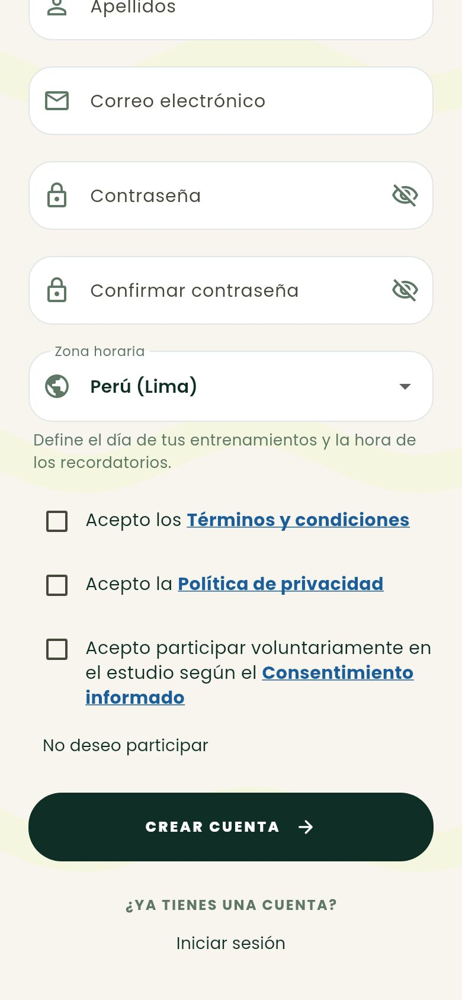
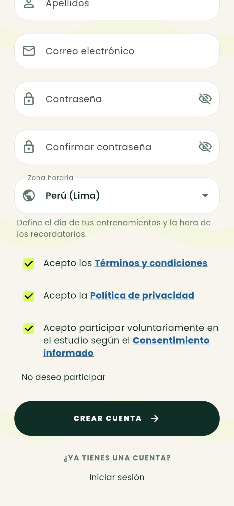
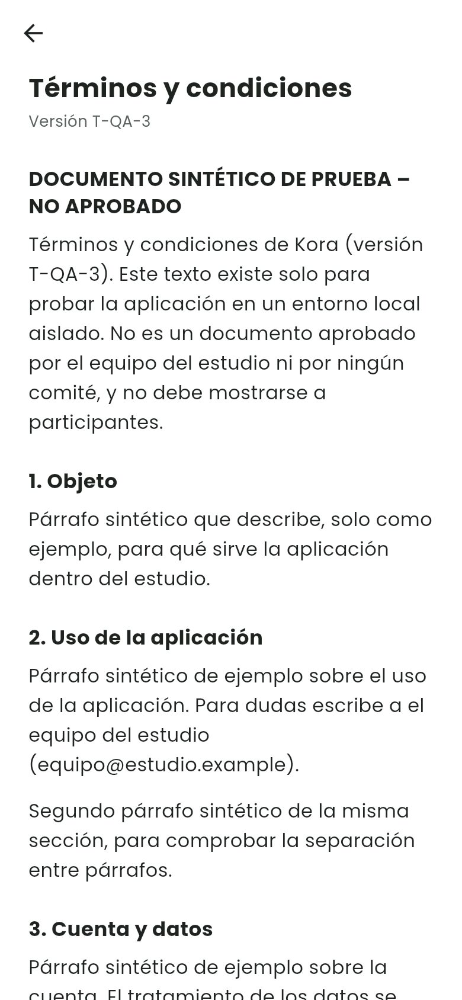
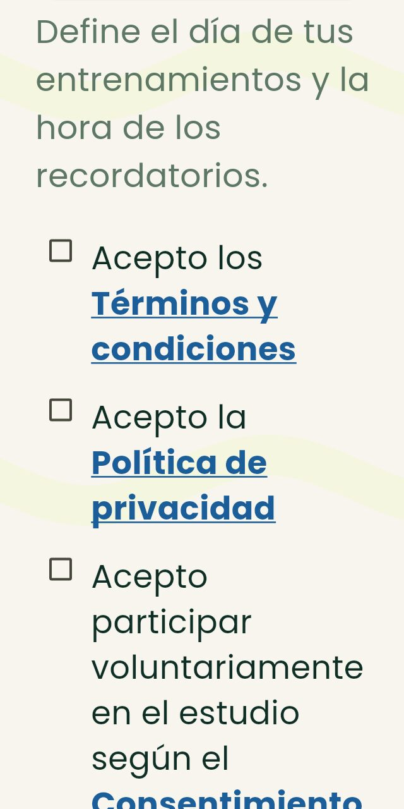
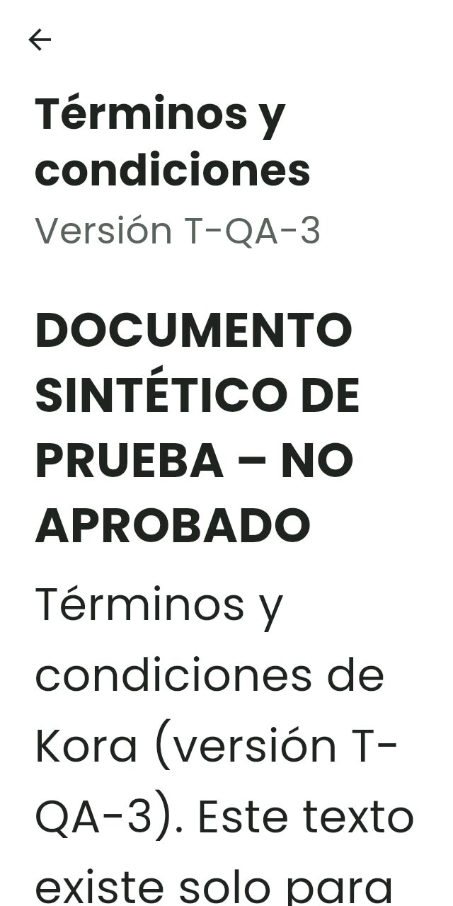
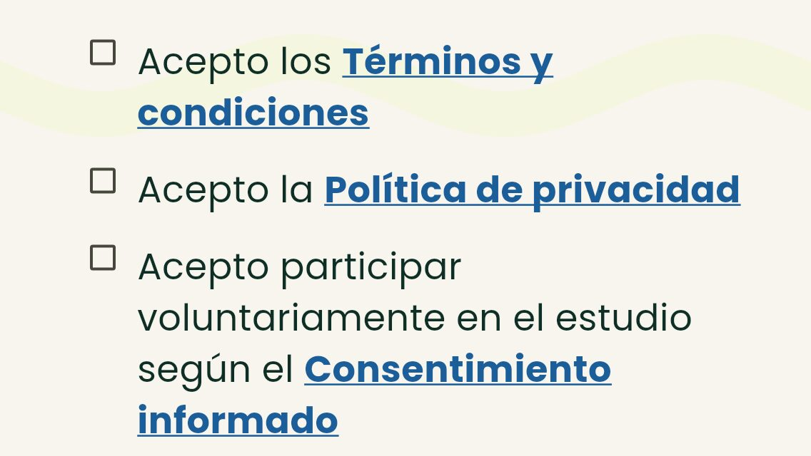
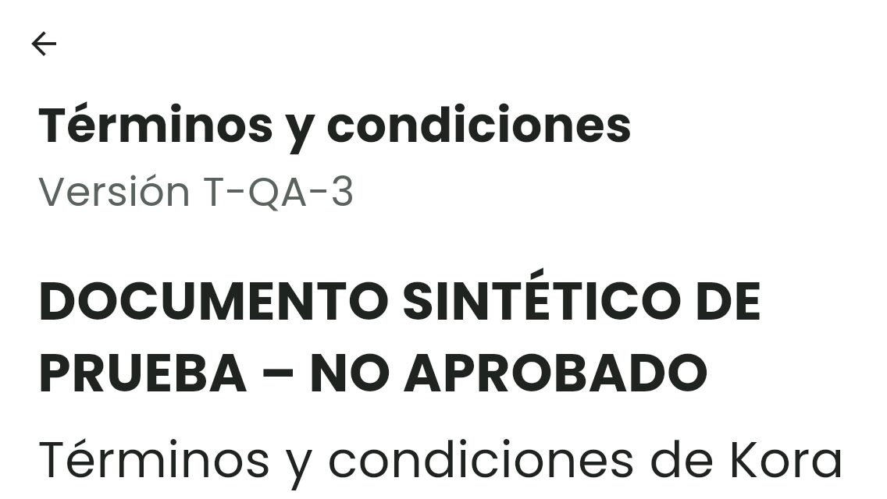
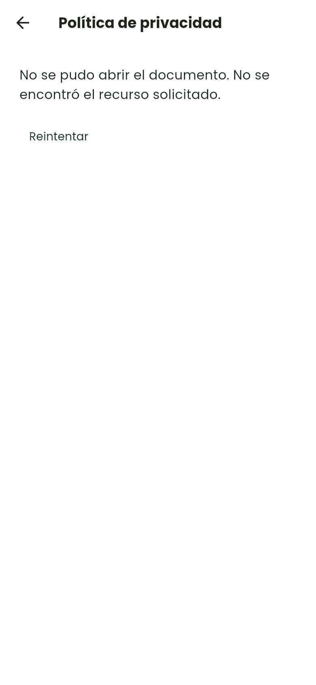
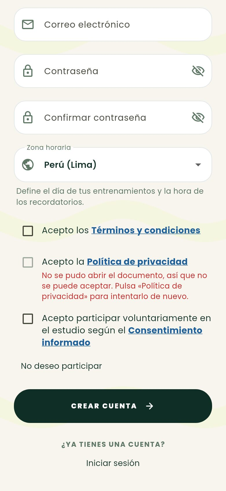

# 12 · Términos y condiciones simplificados

Fecha: 28/11/2026. Orden «Mobile — simplificar términos y condiciones».

| | |
|---|---|
| Mobile de partida | `generation` `c468357d0aef8ea076b53b12320dbe1ac2e3a2c0` (#36 fusionada) |
| Rama | `claude/mobile-terminos-checkbox` |
| Backend usado en las pruebas | `generation` `9aa7abfe800492940ff2e99970ded462e1c48db7`, en local con una base aislada. **Nunca Neon**. Sin cambios en el Backend |
| Documentos | **Sintéticos** («DOCUMENTO SINTÉTICO DE PRUEBA – NO APROBADO»), solo para las pruebas |

## 1. Qué cambia

**Registro.** Cada documento ocupa una línea con su casilla:

- ☐ Acepto los **Términos y condiciones**
- ☐ Acepto la **Política de privacidad** («He leído la …» si el Backend la registra como `CONSTANCIA`)
- ☐ Acepto participar voluntariamente en el estudio según el **Consentimiento informado**

Las casillas empiezan **desmarcadas**. El nombre del documento va en azul, negrita y subrayado. Es un enlace dentro de
la frase y, en la web, se muestra como un `<a>` real para los lectores de pantalla. Al pulsarlo se abre el documento,
pero la casilla **no se marca**: solo se marca o desmarca con la propia casilla. Ya no hay «Leer», ni tarjetas, ni el
título «Documentos del estudio».

**Lector.** Fondo blanco, texto negro o gris oscuro y la tipografía de Kora. Muestra el título, la versión, los
subtítulos y los párrafos en orden, con desplazamiento vertical y flecha para volver. No tiene tarjetas, iconos grandes,
cabeceras de color ni botones de aceptar, y ya no hace falta llegar al final. El título aparece en la barra solo cuando
el título del texto sale de la pantalla, para no repetirlo.

**Se mantiene:**

- Las versiones. El registro envía la versión de cada documento publicado y la comprueba de nuevo justo antes de
  crear la cuenta. Si cambió, la cuenta no se crea y las casillas se desmarcan.
- La opción A. El consentimiento informado conserva su casilla obligatoria, «No deseo participar» no crea ninguna cuenta
  y el registro sigue cerrado mientras falte alguno de los tres documentos.
- Lo que se envía al Backend: los mismos cuatro campos. No hay casillas nuevas.
- **Un documento que no se puede mostrar no se puede aceptar.** Si falla al abrirse, su casilla se desactiva y se
  explica por qué. Si se marcó sin abrirlo, «CREAR CUENTA» descarga antes los documentos. Si uno no se puede mostrar,
  la cuenta no se crea, esa casilla se desmarca y lo escrito se conserva.
- Los formatos de [11](11_DOCUMENTOS_EN_FLUTTER.md) §2: solo HTML o texto, PDF bloqueado, enlaces con su destino y
  nada activo.

**Texto grande.** El texto del documento crece hasta el 200 %. El título del documento se limita al 140 % y la frase de
cada casilla al 170 %. Así «Consentimiento» cabe entero en un teléfono de 320 px sin partirse.

La pantalla que pide aceptar una versión nueva tras iniciar sesión (`ConsentPage`) usa la misma línea.

**Archivos:** `consents/presentation/document_acceptance.dart` (nuevo: la línea con casilla y enlace),
`document_reader_page.dart`, `document_text_repository.dart` (`fetchBlocks`: subtítulos y párrafos; `fetchRaw`: la única
descarga), `consent_page.dart` y `authentication/presentation/widgets/kora_auth_form.dart`. Sin dependencias nuevas.

## 2. Capturas

Renderizadas por Flutter con las fuentes de la app
([arnés](evidencia/arnes/capturas_terminos_simplificados.dart.txt)):

| | |
|---|---|
| Registro, casillas sin marcar (390 × 844) |  |
| Casillas marcadas a mano |  |
| Términos y condiciones |  |
| Registro, 320 × 640, texto al 200 % |  |
| Términos, 320 × 640, texto al 200 % |  |
| Registro, horizontal 568 × 320, 200 % |  |
| Términos, horizontal 568 × 320, 200 % |  |
| Política que no se pudo abrir |  |
| De vuelta: casilla desactivada y explicada |  |

En la app real (Flutter web, compilación release) contra el Backend local:
[W-01](capturas/terminos_simplificados/W-01-registro-casillas-sin-marcar.jpg) casillas sin marcar,
[W-02](capturas/terminos_simplificados/W-02-terminos.jpg) términos y
[W-03](capturas/terminos_simplificados/W-03-registro-casillas-marcadas.jpg) casillas marcadas. W-02 es idéntica píxel a
píxel a F-03.

## 3. Pruebas automatizadas

`flutter analyze`: sin incidencias. `flutter test`: **552 aprobadas · 0 fallidas · 44 omitidas** (antes 542).

| Requisito de la orden | Prueba |
|---|---|
| Casilla desmarcada al entrar | `registration_consents_test`: «nothing is pre-checked»; `consents_test` |
| Pulsar el texto abre el documento | «tapping «Términos y condiciones» opens the whole document and its version» (título, texto completo, versión) |
| Abrirlo no marca la casilla | La misma prueba, y «the box ticks and unticks…»: abrirlo otra vez tampoco la desmarca |
| Al volver se conserva el formulario | «back from the document, everything typed and accepted is still there» (y se envía tal cual) |
| Marcar y desmarcar | «the box ticks and unticks by hand, without reading to the end; only the box changes it» |
| Sin todas las aceptaciones no hay cuenta | «no account without every mandatory acceptance» y las pruebas de la opción A |
| Lector solo para leer | `document_reader_test`: fondo blanco, texto oscuro, título, subtítulos y párrafos en orden, sin botones, casillas ni tarjetas |
| Contenido sin modificar | Subtítulos y párrafos en el orden del documento; en texto plano se conservan los saltos de línea (las listas siguen siendo listas) |
| Texto grande sin desbordes | Lector a 320 × 568 y 568 × 320 al 100, 130 y 200 % (título sin palabras partidas, hasta el final, «Volver» alcanzable). Registro a 320 px y en horizontal al 100, 130 y 200 % (frases sin palabras partidas, casillas alcanzables) |
| Validación de versiones | Versión nueva durante el registro (no se envía, se desmarca y luego se registra la nueva), 422 con y sin código estable, documento retirado |
| Documento no disponible | Dirección rota o PDF: casilla desactivada y explicada. Marcada sin abrirlo: comprobación previa, sin cuenta |

## 4. Prueba de integración (Backend local `9aa7abf`)

[Recorrido](evidencia/terminos_simplificados/recorrido-app-web-9aa7abf.txt) con
[arnés](evidencia/arnes/recorrido_terminos_simplificados.js.txt), sobre la app web real y con documentos sintéticos:
**12/12 comprobaciones**. Casillas desmarcadas; el nombre es un enlace; abre los términos con la versión `T-QA-3`, sus
subtítulos y sus párrafos; no hay botón de aceptar; abrirlo no marca la casilla; las casillas se marcan y desmarcan;
lo escrito se conserva; la cuenta se crea con `T-QA-3`, `P-QA-1` y `C-QA-1`.

El Backend registró esas versiones como `CASILLA_REGISTRO`, con la cuenta como participante activa
([consulta](evidencia/terminos_simplificados/consentimientos-registrados-9aa7abf.txt)).

## 5. Sin cambios

Autenticación, recuperación de contraseña, generación y adaptación del plan, O20/V65, D-M1, P1, P2, adherencia y
navegación: sus pruebas siguen en verde y no se modificaron. Tampoco cambian `main`, el Backend ni Neon. No hubo
despliegue ni APK de producción.

Las 46 comprobaciones de la matriz en teléfono Android físico siguen **sin ejecutar** ([11](11_DOCUMENTOS_EN_FLUTTER.md)
§8).
