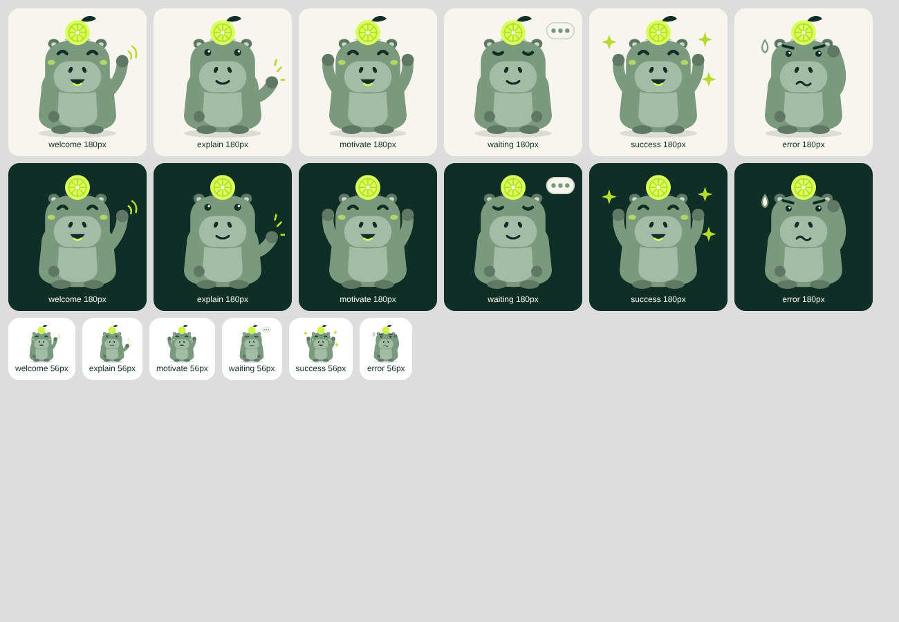
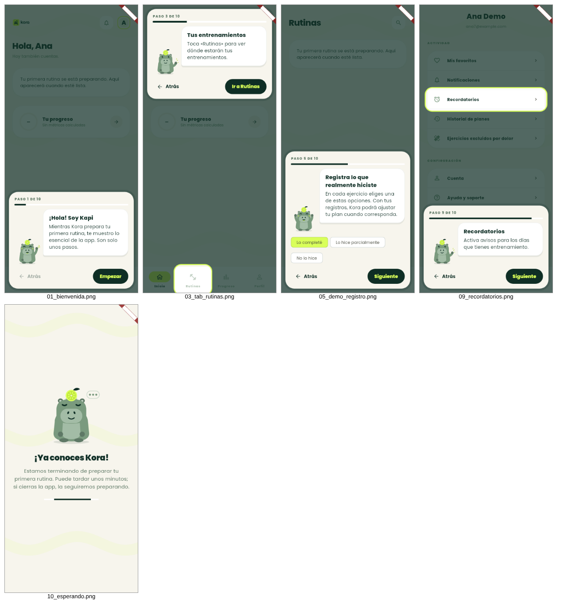

# Bienvenida de Kora: mascota, recorrido y primera rutina

Documento de diseño. Todo lo descrito aquí se basa en el código actual de la app
(rama `generation`) y en el backend `Fitsense-Real/Backend` (rama `generation`, V57).

## 1. Inventario de pantallas reales

| Pantalla | Archivo | Ruta / acceso |
|---|---|---|
| Bienvenida (splash) | `authentication/presentation/pages/splash_page.dart` | `/splash` |
| Inicio de sesión / registro | `widgets/kora_auth_form.dart` | `/login`, `/register` |
| Recuperar / restablecer contraseña | `forgot_password_form.dart`, `reset_password_form.dart` | `/forgot-password`, `/reset-password` |
| Preparación de cuenta | `plans/presentation/account_setup_page.dart` | `/account-setup` |
| Perfil inicial (5 pasos) | `onboarding/presentation/onboarding_page.dart` | `/onboarding` |
| Generando (30 s con Kapi) | `onboarding/presentation/generating_plan.dart`, `kapi_fun_messages.dart` | dentro de onboarding; ver `GENERACION_30S_Y_EQUIPAMIENTO.md` |
| Dashboard: Inicio, Rutinas, Progreso, Perfil | `dashboard/presentation/pages/dashboard_page.dart` | `/dashboard?tab=0..3` |
| Rutina (sesión en vivo, registro, omitir) | `workouts/presentation/planned_workout_page.dart` | desde Inicio/Rutinas |
| Resultado de ejercicio, finalizar, falta de tiempo | `exercise_result_dialog.dart`, `planned_workout_page.dart` | diálogos |
| Cronómetro y cuenta regresiva | `workouts/presentation/session_timer.dart` | en la rutina |
| Instrucciones del ejercicio | `ExerciseInstructions` | hoja desde la rutina |
| Novedades del plan, Cuenta, Recordatorios, Historial de planes, Exclusiones por dolor, Ayuda | hojas del Perfil | Perfil |
| Selector de equipamiento (peso corporal incluido) | `equipment_picker.dart` | perfil inicial. El selector de ejercicios a evitar se retiró (noviembre de 2026) |

No existen en la app: chat con entrenador, pantalla de logros, tienda ni ajustes de tema
visibles. El recorrido no los menciona. Los PDF originales de los mockups no están en el
repositorio; solo se conservan las fotos y el logo extraídos (`assets/images/kora/`).

## 2. Paleta oficial (extraída del código)

| Uso | Color | Origen |
|---|---|---|
| Lima (marca) | `#D9FF59` | `Kora.lime`, `AppColors.primary` |
| Bosque (texto, fondos oscuros) | `#0F2E25` | `Kora.forest`, `AppColors.primaryDark` |
| Marfil (fondo) | `#F7F5ED` | `Kora.ivory`, `AppColors.lightBackground` |
| Salvia | `#7A9A7E` | `Kora.sage`, `AppColors.secondary` |
| Musgo (texto secundario) | `#5E7865` | `Kora.muted`, `AppColors.lightTextSecondary` |
| Lima suave | `#F0F6D4` | `AppColors.primarySoft` |

Tipografía: Poppins (400–900), incluida en `assets/fonts`. Para dar volumen a la mascota
se usan tres pasos derivados: salvia clara `#A3BCA6`, salvia pálida `#C9D8C9` y lima
profunda `#B6DB2E`. Un test verifica que los SVG no usan ningún otro color.

## 3. Mascota

### Alternativas consideradas

| Animal | A favor | En contra |
|---|---|---|
| Zorro | Ágil, expresivo | Connota astucia y velocidad; su naranja no existe en la paleta; orejas y hocico finos se pierden a 48 px |
| Nutria | Juguetona, cercana | Energía alta; sin vínculo con la marca |
| Panda | Tranquilo, reconocible | Muy usado (WWF); asociado a la pereza; blanco y negro ajenos a la paleta |
| Tortuga | Constancia | Transmite lentitud y vejez; poco expresiva |
| **Capibara** | Calma, sociabilidad y constancia: "a tu ritmo"; silueta redonda que funciona en tamaños pequeños; no intimida a principiantes ni a mayores | Es tendencia: hay que darle un rasgo propio |

### Recomendación: **Kapi, la capibara con una lima en la cabeza**

- Tono: Kora no premia la intensidad sino la constancia ("Tu rutina también cuenta",
  "Pequeños pasos"). La capibara es el animal más asociado a la calma y la convivencia,
  y acompaña sin juzgar, que es lo que pide un estudio de adherencia.
- Rasgo propio: a la capibara se la reconoce mundialmente con una fruta en la cabeza.
  Aquí lleva **una lima**, el color insignia de Kora, con su hoja en verde bosque. El
  personaje queda unido a la marca y se distingue de otras capibaras.
- Estilo: plano, geométrico y redondeado, sin contornos, igual que el logo.
- No es un entrenador: sus mensajes explican la app y nunca dan indicaciones médicas
  ni deportivas fuera de las reglas del sistema.

### Expresiones

| Expresión | Uso | Rasgos |
|---|---|---|
| `welcome` | Saludo inicial | Pata en alto, sonrisa abierta |
| `explain` | Pasos del recorrido | Señala hacia el elemento resaltado |
| `motivate` | Final del recorrido | Brazos arriba |
| `waiting` | Generación en curso | Ojos tranquilos, burbuja de puntos; sin porcentajes |
| `success` | Rutina lista | Brazos arriba, destellos lima |
| `error` | Error o no factible | Cejas preocupadas, pata en la cabeza, gota |

Formato: un SVG por expresión (`assets/images/mascot/kapi_*.svg`, 1–3 KB cada uno),
generado por `tool/mascot/generate_mascot.py` a partir de partes comunes para que las
seis sean consistentes. El componente `KoraMascot` solo carga el archivo, así que un
ilustrador puede reemplazar los SVG por el arte definitivo sin cambiar código.
Animación: un flotar lento, una "respiración" en `waiting` y un fundido al cambiar de
expresión. Con "reducir movimiento" del sistema es estática.

## 4. Recorrido propuesto

**Formato elegido: híbrido.** El recorrido ocurre sobre el **dashboard real** (no capturas
ni pantallas falsas): un velo oscurece la interfaz y deja visible solo el elemento que se
explica, con un anillo lima. En los pasos de navegación el usuario **toca la pestaña
real** para avanzar; el botón "Siguiente" hace lo mismo para quien usa lector de pantalla.
Solo hay una pequeña demostración, el registro de resultados, porque sin un plan
todavía no hay un entrenamiento real que abrir, y no se inventan entrenamientos.

| # | Pantalla real | Elemento resaltado | Mensaje de Kapi (resumen) |
|---|---|---|---|
| 1 | Inicio | — | Bienvenida: mientras Kora prepara tu primera rutina, te muestro lo esencial |
| 2 | Inicio | Tarjeta "Tu plan de la semana" | Aquí verás tu plan semanal; tu primera rutina aparecerá aquí cuando esté lista |
| 3 | Barra inferior | Pestaña Rutinas (interactivo) | Toca «Rutinas» |
| 4 | Rutinas | Lista de entrenamientos | Día y duración; empezar en vivo con cronómetro y descansos, o registrarlo si ya lo hiciste |
| 5 | Rutinas | Demostración de los tres resultados reales | Registra lo que realmente hiciste; con tus registros Kora podrá ajustar tu plan cuando corresponda |
| 6 | Barra inferior | Pestaña Progreso (interactivo) | Toca «Progreso» |
| 7 | Progreso | Sección de adherencia | Qué parte de tu plan cumpliste cada semana y los ajustes |
| 8 | Barra inferior | Pestaña Perfil (interactivo) | Toca «Perfil» |
| 9 | Perfil | Recordatorios | Activa avisos para los días que tienes entrenamiento |
| 10 | Perfil | Ver recorrido de Kora | ¡Ya conoces Kora! Desde aquí puedes volver a verlo |

Durante el recorrido el dashboard no carga los datos del usuario: muestra el estado vacío real
("Tu primera rutina se está preparando") para que el primer plan se presente solo al terminar,
y no se piden permisos de notificaciones a mitad de camino.

Reglas: obligatorio la primera vez, sin botón para saltarlo; atrás y siguiente; indicador
"Paso n de 10"; el progreso se guarda por usuario en el almacenamiento seguro del
teléfono en cada paso, y solo el último paso lo marca como completado. Se puede repetir
desde Perfil → Ver recorrido de Kora. Las interacciones bloquean todo lo que no sea el
elemento resaltado: nada del recorrido crea, registra ni omite entrenamientos.

## 5. Primera rutina en segundo plano

Al terminar el perfil, la app pide la generación (`POST /users/me/plan/generation`),
guarda el identificador de la operación y abre el recorrido de inmediato. Mientras tanto
consulta el estado sin bloquear. Al terminar el recorrido:

- **Lista antes** (caso A): Kapi celebra y presenta el plan. El recorrido no se interrumpe.
- **Aún en curso** (caso B): Kapi espera con un mensaje sin porcentajes ni tiempos prometidos.
- **Falla o no factible** (caso C): explicación y, si corresponde, reintento seguro; un error de
  conexión se distingue de un error del servidor.

Contrato y detalles del backend: PR del backend "generación inicial asíncrona".
